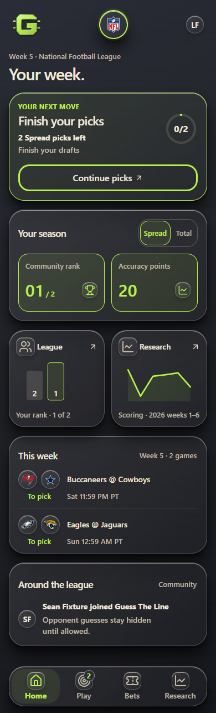
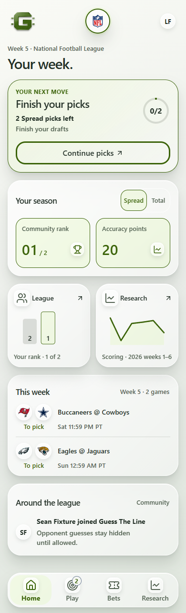

# Home spacing review — November 7, 2026

Owner: Sean Balsiger. Status: **approved and deployed** as Pages `6a847959` from
`70c2b85ea7466ca308c8e69006b4ec09888267a7`. See the
[release record](../../docs/RELEASE_2026_11_07_HOME_SPACING.md).

Sean approved the exact Dark/Light review visuals and `preview.css` at review
commit `5faead67b9a66091c595168d89bfe21556dec01f`, saying **“That looks better.
Continue to deploy.”** The implementation ports those rules into the existing
`web/src/next/home/approvedHome.css` declarations, limited to NFL Home.

Sean requested better formatting and spacing across the page after the approved
Home deployment. This review covers the NFL Home landing, retaining its selected
glass finish, colors, typography, content order, figures and controls. It does not
extend the Home redesign to other pages. The Spread / Total selector and each
team's individual circular background remain.

## Approved result

| Dark | Light |
| --- | --- |
| [Top viewport](proposed-dark-top.png) | [Top viewport](proposed-light-top.png) |
| [Bottom viewport](proposed-dark-bottom.png) | [Bottom viewport](proposed-light-bottom.png) |
| [Whole-page overview](proposed-dark-overview.png) | [Whole-page overview](proposed-light-overview.png) |
| [Bottom with simulated phone insets](proposed-dark-safe-area-bottom.png) | [Bottom with simulated phone insets](proposed-light-safe-area-bottom.png) |

The top/bottom captures use a 390 × 844 CSS-pixel browser viewport. The overviews
expand that viewport to the document height, placing the fixed navigation at the
bottom of the overview; they are not a physical phone viewport or proof of iPhone
acceptance. The safe-area images simulate 47px top / 34px bottom insets in CSS.

Compare the current source: [Dark top](before-dark-top.png),
[Dark overview](before-dark-overview.png), [Light top](before-light-top.png),
[Light overview](before-light-overview.png). Both variants use the same local
fictional fixture, not a signed-in production account.

## Approved layout

Use balanced spacing: 16px page gutters and section gaps, 12–16px card padding,
and a shared alignment grid. Move the progress ring alongside the action text;
put stat icons next to their values; align shortcut icons with their headings;
pair matchup logos with the names and time. Tighten the week header and activity
rhythm. Keep all text, charts and 44px minimum touch targets.

At 390px, the same fixture's document height changes from **1,561px to 1,279px**,
a **282px / 18.1% reduction**. The League and Research graphics now fit above the
floating navigation on the initial 844px viewport. The last activity row remains
reachable with clearance above that navigation when scrolled to the end.

| Section | Current height | Proposed height |
| --- | ---: | ---: |
| Primary action | 214px | 194px |
| Your season | 226px | 200px |
| League / Research shortcuts | 228px | 174px |
| This week | 315px | 211px |
| Around the league | 164px | 150px |

Reducing only the outer gaps would leave the oversized card interiors intact.
A dense alternative with smaller graphics would save more space but weaken the
visual emphasis Sean requested. The balanced proposal keeps the original 80px
chart height and reading text sizes while addressing stacked spacing throughout
Home. SVG rank labels are enlarged so their rendered size stays at least 12px,
including at 320px. The existing progress-pop animation targets the ring after
its wrapper becomes layout-transparent; reduced motion remains respected.

## Evidence and boundaries

The original mockup browser rendered unchanged app source from main
`42a5ad9930a5712c6b357564701fbb5628b12b43` (the deployed Home source plus its
release record). [preview.css](preview.css) was injected into the review browser only;
the app does not import that review artifact. The implementation changes only
Home CSS, its spacing assertion and approval/status documentation. API, database,
migration, provider, controllers, source data and build configuration remain
unchanged. The frontend release is verified in the linked release record.

The fixture uses the repository's real cloud handler and all local migrations on
PGlite, with `createCommunityWorld` and `seedFinishedWeek`. Accounts, rank, points,
games and kickoff labels are fictional test data. The mini Research chart keeps
the existing attributed public historical scoring series. All requests to hosted
accounts and live data providers are blocked; only the loopback app, loopback
fixture server and fake Supabase request interception are used. Webfonts are
blocked, so the app's system font fallback is shown here.

Checked using Playwright CLI / Chrome, both themes:

- 30 layout cases: 320, 359, 360, 390, 430, 768 and 1440px widths with the native
  fallback and wider Verdana; plus two 390px simulated-inset cases. No horizontal
  overflow, clipped text, overlapping content controls or targets below 44px.
- 24 sequential keyboard-focus observations with simulated insets; every checked
  Home content control cleared the floating bar.
- Axe WCAG 2 A/AA, 2.1 A/AA and 2.2 AA: zero violations in either theme. Automated
  color-contrast evaluation remained incomplete on translucent backgrounds; this
  is not a claim of full accessibility conformance.
- Existing canonical token/brand suite: 15/15 passed. The preview adds no colors
  or font tokens and uses the existing Home finish and spacing tokens.

The wider-font pass caught a 360px shortcut-label fit problem; a 4px column gap
resolved it before final capture. The simulated-inset check uses the same
scroll-padding selector specificity as the existing Home stylesheet. It does not
change that production rule or claim a physical-device test.

[evidence.json](evidence.json) preserves the original timestamped preview's
dimensions, results and file hashes. Its pre-approval status is historical;
Sean's later approval and the hosted release are recorded here and in the release record.
Sean's approval satisfies his standing mockup-first instruction for these exact
visuals. The protected manual workflow completed with fresh exact-source
evidence; the wider redesign is a separate ongoing rollout.

## Implementation verification

The source preserves the selected Home tokens, fonts, glass finish, content and
44px targets, with 80px charts and 15px SVG rank labels. The ring shares the
wrapper's existing named pop animation (equivalent to the preview's inheritance);
the canonical reduced-motion guards still stop both. Safe-area and focus-scroll
padding rules are retained. No additional duplicate preview cascade is imported.

Local checks: the canonical token and Home model/hero/moment suites passed 54/54;
seven existing Home component suites passed 53/53. The existing Home and
scroll/navigation browser specs passed 7/7 (no skips), including both-theme
320/390px layout/axe, hidden-market leak/no-write checks, navigation restoration
and cross-page scrolling/focus checks. The browser command built the current
cloud-test app successfully. These checks use local fictional PGlite accounts;
these local checks do not establish physical-phone acceptance. Final hosted
deployment evidence is recorded separately in the release record. The loading
repair passed all 17 Home/layers/scrolling cases and 40 focused Node checks.
