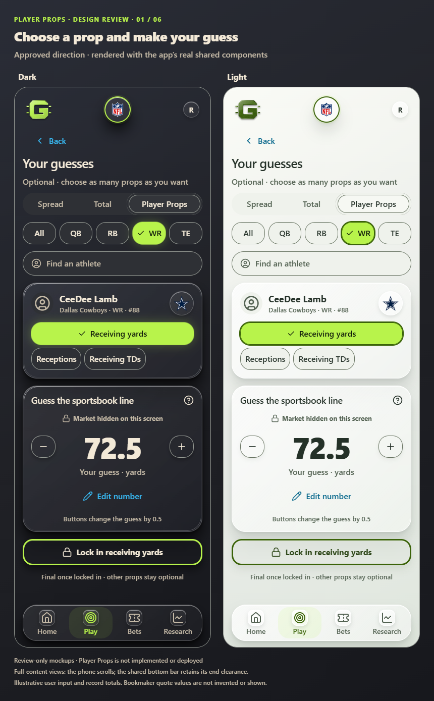
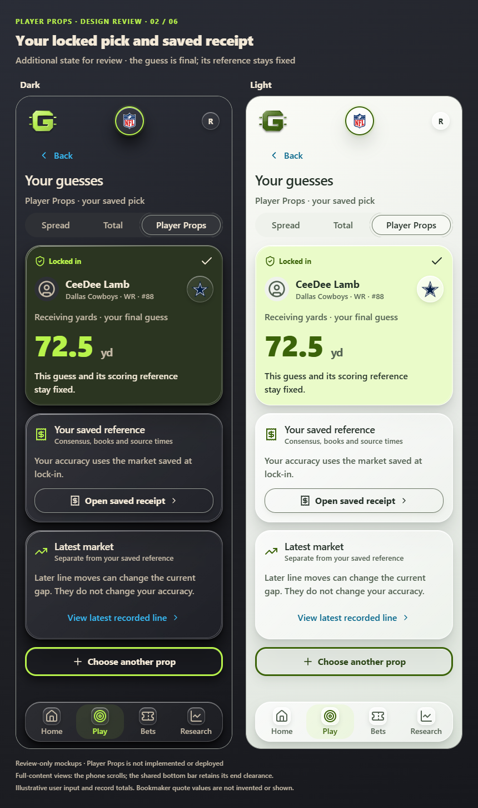
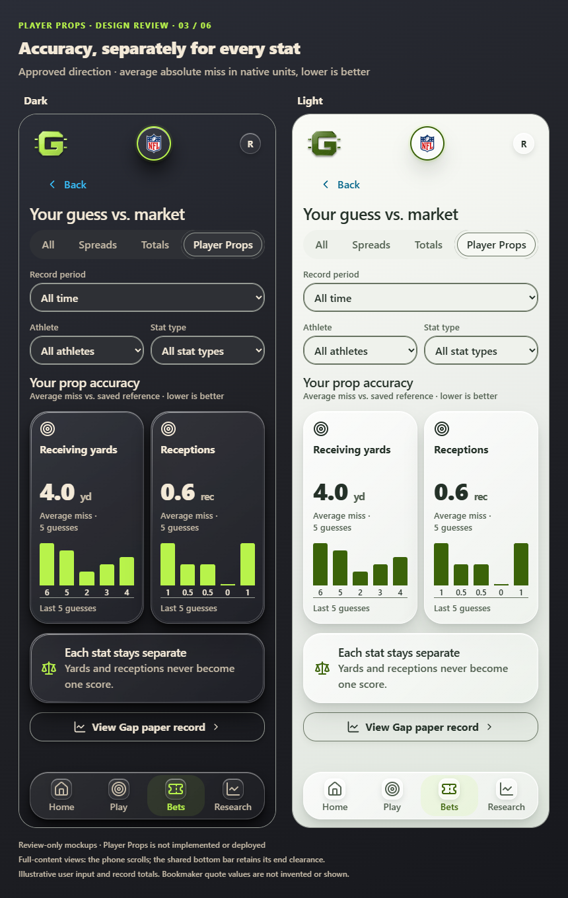
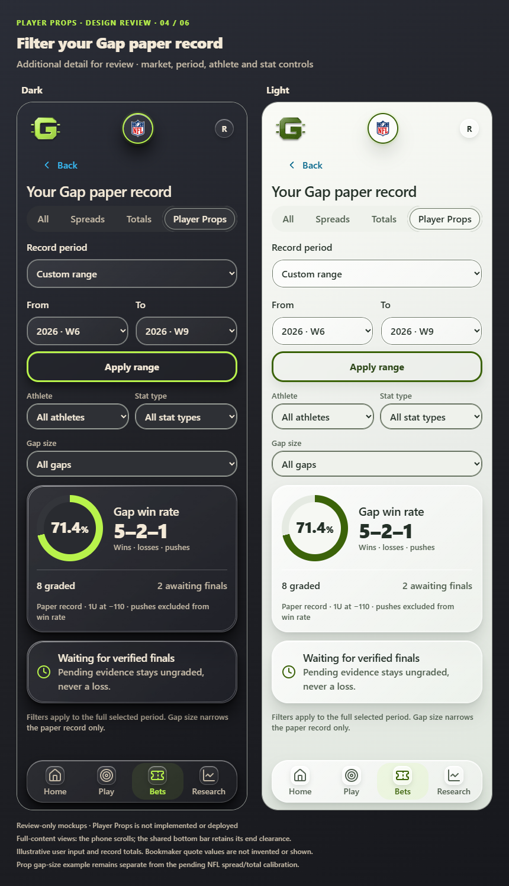
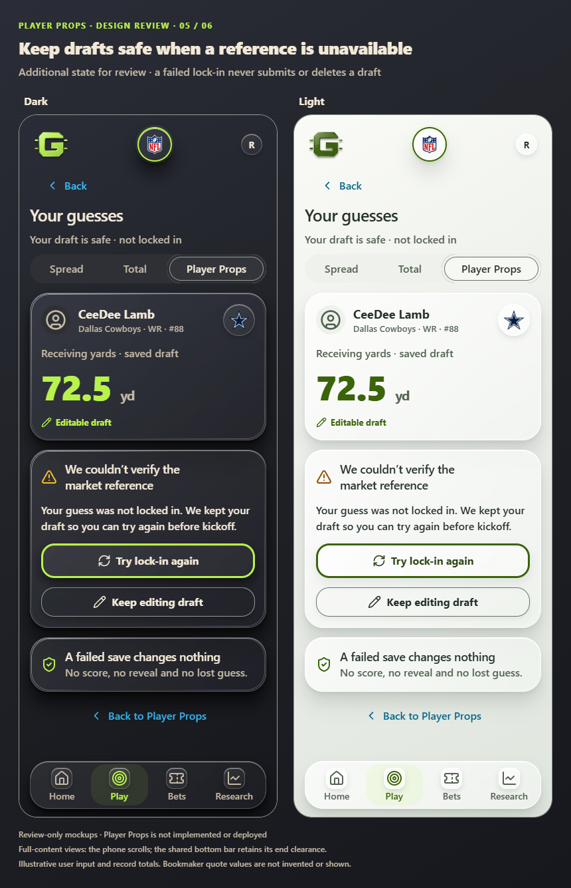
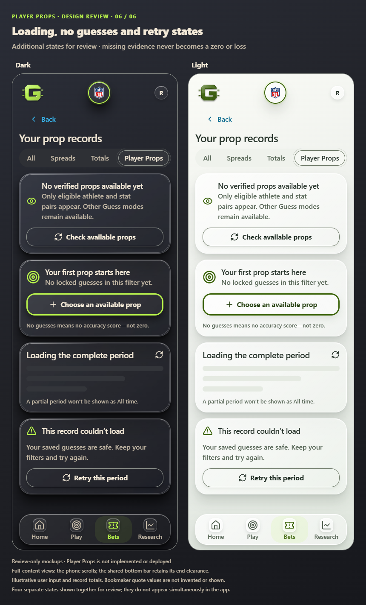

# Player Props — full visual review

Owner: Sean Balsiger. November 9, 2026.
Status: all six visual sheets approved; not implemented or deployed.

This packet covers **Player Props only**. Sean selected this scope explicitly.
The original entry and accuracy/Gap direction is approved with alignment to the
rest of the app required. These six sheets render that direction using the real
shared app components. After reviewing the complete set, Sean answered
**"Approve the visual set"** on November 9, 2026. This approves these exact six
sheets, including locked-pick, filter, recovery and missing-data states, as the
visual implementation authority for their shown compositions. It does not
authorize an apply or release, approve an unshown new composition or prove
live data readiness. [Approved rules](../../docs/superpowers/specs/2026-11-09-player-props-design.md)
and [data-readiness evidence](../../docs/PLAYER_PROPS_READINESS_2026_11_09.md)
remain authoritative.

Both themes appear on every sheet. Views are expanded to show the full content;
ordinary phones scroll and retain the existing measured bottom-bar clearance.
These are visual previews, not physical-phone acceptance. Values are illustrative
user inputs and aggregate records; no bookmaker line is invented or shown.
The locked-pick sheet shows receipt access; the opened receipt reuses the existing
approved layout with the prop's athlete/stat/unit/event and source-time fields.
It is not a new separately designed page in this packet. Quote values and source
times remain dependent on verified data, not supplied by these previews.

| Sheet | What to review | Approval status |
| --- | --- | --- |
| [01 — Entry](01-entry.png) | Player Props beside Spread/Total; position/search, athlete/stat, half-point controls, direct editor, final per-prop lock | Approved exact sheet |
| [02 — Locked pick](02-locked.png) | Final guess, saved-reference receipt access, latest market kept separate, choose another prop | Approved exact sheet |
| [03 — Accuracy](03-accuracy.png) | Period/athlete/stat filters; independent average-miss cards/charts in native units | Approved exact sheet |
| [04 — Paper record](04-record.png) | Week/season/all-time/custom, inclusive From/To, athlete/stat/gap filters, W–L–P and pending finals | Approved exact sheet |
| [05 — Draft recovery](05-recovery.png) | Failed reference verification preserves an editable draft and offers retry before kickoff | Approved exact sheet |
| [06 — Missing/loading/error](06-empty.png) | No verified lines, no guesses, full-period loading, retry without false zeros or partial totals | Approved exact sheet |

## Confirmed behavior behind the mockups

- Guess the sportsbook line; choose an athlete and stat from eligible lines.
  Participation is optional with any number of props.
- Passing: yards, completions, attempts, touchdowns, interceptions. Rushing:
  yards, attempts, touchdowns. Receiving: yards, receptions, touchdowns. All
  eleven are offered only where verified available; position filters do not
  exclude a legitimate cross-position stat.
- Plus/minus changes the guess by 0.5; the direct numeric editor remains.
  This is a prop-line input, not a change to Virtual Units stakes.
- Drafts stay editable until actual kickoff. A successful per-event/player/stat
  lock is final, uses an immutable saved scoring reference and is reused across
  the user's groups. The same athlete's other stats remain independent.
- Accuracy is mean absolute miss from that saved reference, by stat type in its
  own unit. Lower is better; no combined yard/reception score. No guesses is
  unavailable, not zero. Later quotes do not rewrite accuracy.
- Market numbers are hidden only on the guess-entry screen. Existing Research
  and other users' tracked-prop quote visibility remain unchanged. Private drafts
  and opponent guesses retain their separate access protections.
- Period/athlete/stat filters narrow the personal views. The gap-size filter
  narrows the separately labelled paper record only. All time means retained
  eligible records, not a promise of uncollected historical bookmaker lines.
- Paper results use the last qualifying retained pre-kickoff reference, verified
  actual player stats and D-77's 1U at standard minus 110 convention. Missing
  evidence, unresolved DNP/cancellation/correction remains ungraded. Pushes are
  outside wins/(wins+losses). Prop filtering is separate from PR #508's NFL
  spread/total calibration; fresh-main reconciliation precedes implementation.
- Existing receipts/History/shared-pick patterns retain their approved layouts,
  prop identity/units, source times and permissions. No new leaderboard or award
  rule is introduced by this packet.

## Shared design and capture evidence

The preview imports the actual `Card`, `Button`, `Chip`, `Segmented`, `Icon`,
`TeamMark`, `Skeleton`, `TopBar`, `TabBar`, `DetailBack` and `GapPeriodControl`
components and current token/base/component/shell/overview/Gap styles. It reuses
the selected hybrid G, real circular team/league artwork and common four-tab
navigation. No product source, token, font, icon or header policy was changed.
Artwork follows existing [app provenance](../../docs/TEAM_LOGO_SOURCES.md) and
`web/src/next/ui/brand-assets/sources.json`; marks identify the example athlete's
team/league and do not claim endorsement.

All twelve captured theme views have no capture-time page errors or horizontal
overflow and place the final control above the shared bottom bar. A separate
24-case preview check at 320/390 × 844 in both themes verifies 16px control labels,
44px targets, contained control text, no horizontal page overflow and a final
control reachable above the bottom bar after scrolling. The initial preview had
smaller label/Edit overrides and an undersized All segment on narrow screens;
these are corrected in the final sheets with shared size tokens. They are
synthetic, full-content Chromium previews; no saved account, private guess,
verified market quote, production API call or hosted write is used. An initial
isolated capture used a FrameLocator as a Frame; that runner error was corrected
before the saved captures. A missing preview-only Gap stylesheet was also
corrected; sheet 04 here is the final two-column version. Preliminary HMR warnings
and the initial favicon request are local preview setup observations, not product
defects or a claim of a complete runtime/physical-phone audit.

[Manifest and SHA-256 values](manifest.json) bind approval to the exact sheets.
The images retain their review-stage captions as provenance; this dated approval
and manifest supersede their awaiting-review labels. Raw preview source, capture
logs and local browser artifacts remain ignored. Approval of the mockups remains
distinct from live-source verification, implementation, required
CI, named migration apply and production deployment.

## 01 — Entry

## 02 — Locked pick and receipt access

## 03 — Separate accuracy by stat

## 04 — Period and paper-record filters

## 05 — Draft recovery

## 06 — Missing, loading and error states

The four examples on this last sheet are **separate states** displayed together
for review. They are not four cards shown simultaneously in the app.

