## Play score and history mocked — November 5, 2026

Sean selected the recommendation to continue with labelled historical examples.
The score review now has separate Spread/Total weekly summaries, game cards,
week chips, team AND matchup filters, filtered subtotals, a three-week history
view and opened game accuracy charts in dark/Porcelain. Cards retain individual
team-logo tiles and the selected clear glass, ivory/ink type and lime emphasis.
The first six games lead; Show all exposes each week’s full 14-game example.
History bars share a fixed 0–10 points/game scale and open their week.

Public completed-game records for Weeks 6–8 (42 games, 84 market references)
match the existing November 5 publication’s completed-source SHA-256:
`48fbdd6f9f63ffcc0a0322dd7f5b22fa0faa0303874f21200baebff5d30831df`.
The upstream [nflfastR reference](https://nflverse.r-universe.dev/nflfastR/nflfastR.pdf#page=27)
defines spread_line and total_line as closing lines, with positive spread_line
meaning the home team was favored. The adapter negates that spread for GTL’s
home-referenced sign and uses native appCode for historical team aliases.

Guesses are **fictional samples**, and the resulting example points use the
unchanged accuracy helper (10 minus twice the gap, floored at zero), which agrees
with the SQL scorer. These recorded closing references are not anyone’s saved,
qualifying submission-time reference, current quotes or three-book consensus.
No player accounts, private guesses, rank, quote-observation/save time or book
identity is invented. The production saved-reference scorer is unchanged.

Presentation reuses scoreRows/scoreSummary, heroModel/rowView/gameView,
WeekChips/FilterToggle/Segmented and the native number-line component’s exact
isolated body. Only its supplied labels identify the historical/sample context;
its geometry is retained. The source distinction and recorded final are behind
About this example game. Score accuracy remains separate from the game outcome.

Ten extended-height phone captures were inspected. **Visual approval remains
pending.** They are visual review assets, not physical-device acceptance,
production integration, live account evidence or whole-project completion.

Checks passed: 84 independent reference/arithmetic validations; eight responsive
layouts (320/390/768/1440 × dark/light), 672 displayed score rows, 48 native axis
checks, 24 filter cases and 48 history-bar checks. Four additional narrow-phone
cases covered zero points, opposite favored sides, nonexact marker/gap placement,
44px controls and navigation clearance; 112 registered-logo loads passed. Prior
Points and Fantasy Rankings views mount. Corrected-source runs produced no page
errors or non-GET requests. Deterministic preparation, exact number-line copy,
production-reader exclusions, Brand QA and syntax/diff checks passed.

Production code/tokens, private data, previous source exports, collectors, free
budgets, scoring, migrations, frozen v62, deferred avatars/awards and parked
Signal files are unchanged. No merge or deployment was performed.

[Spread Week dark](previews/score-spread-week-dark-phone.png) ·
[Total Week dark](previews/score-total-week-dark-phone.png) ·
[Spread Game dark](previews/score-spread-game-dark-phone.png) ·
[Total Game dark](previews/score-total-game-dark-phone.png) ·
[History dark](previews/score-history-dark-phone.png) ·
[Spread Week light](previews/score-spread-week-light-phone.png) ·
[Total Week light](previews/score-total-week-light-phone.png) ·
[Spread Game light](previews/score-spread-game-light-phone.png) ·
[Total Game light](previews/score-total-game-light-phone.png) ·
[History light](previews/score-history-light-phone.png).

## Guess the Points direction approved — November 5, 2026

Sean explicitly confirmed "Approved continue" after the Guess the Points review.
The supplied five-player overview, opened draft, lock-in confirmation and linked
native usage-profile direction are approved in the selected dark/Porcelain
system. The [selection record](selected-system-review.json) binds this approval to the reviewed
commit and captures. The fixed lineup and draft values remain labelled examples.

This is visual acceptance of the supplied direction, not separate acceptance of
all unseen players/states, the unshown preview-confirmed card, actual account
saves, production integration or whole-project completion. No UI, data or image
changes accompany the approval record. Continuing with Play score/history is
authorized; a data-presentation question is pending before those mockups are built.
Deferred avatars/awards and parked Signal files remain unchanged.

## Guess the Points mocked — November 5, 2026

Sean approved moving on to Guess the Points. The selected review now shows a
five-position week overview, opened player draft, lock-in confirmation, usage
profile and in-memory preview-confirmed card in dark and Porcelain. Each team
mark has its own glass tile. Five fixed public NFL players form an explicitly
labelled **example lineup**, not the published Points slate: Josh Allen (QB),
Bijan Robinson (RB), Ja’Marr Chase (WR), Brock Bowers (TE), Justin Jefferson (FLEX).
Prefilled guesses 24/18/22/14/20 are sample user entries only.

The overview’s small charts, recent/season averages, opponent-allowed values and
usage profile use the existing public Week 9 Fantasy snapshot and native player
context/profile helpers. Every example’s kickoff matches the validated public
schedule. Native context-number formatting preserves the same rounded tenths as
the full profile, including Chase’s last-three-calendar-weeks average of 24.2
(two recorded games). Phone-width context charts remain visible. The existing
PointsProfile keeps the House estimate behind its original lock line; a local
demo lock never grants server reveal permissions or fabricates member guesses.

The 0–60 whole-point stepper is copied exactly from the native component, with
±1 taps, held ±5, arrows/Page keys and boundary behavior. Save draft and Confirm
lock-in change memory only. Edits survive overview/profile visits, and a lock in
one slot leaves the others separate. The Points board tile opens GTL’s existing
board in a new tab; this does not claim a new board mockup or live result read.
No account/API/storage/save readers or writers are imported into the preview.

Ten extended-height phone captures are available. **Visual approval remains
pending.** These are presentation captures, not physical-iPhone acceptance,
production integration or whole-project completion.

Checks passed: eight responsive theme/width layouts (320/390/768/1440), 40
independent decimal-weight context/chart comparisons, 48 profile/House-gate
checks, 40 draft/profile/overview preservation cases and eight stepper/confirmation
flows. Four narrow-phone scroll/touch checks verified navigation clearance and
44px minimum control heights; two held-five-point checks passed. Prior Spread
and Fantasy Rankings views still mount. No page errors or non-GET requests were
observed. Native stepper-copy equality, unchanged public snapshot SHA-256,
production-reader exclusions, Brand QA and syntax/diff checks passed.

Production code/tokens, private picks, source exports, collectors, budgets,
scoring, migrations, frozen v62, deferred avatars/awards and parked Signal files
are unchanged. No merge or deployment was performed.

[Week dark](previews/points-week-dark-phone.png) ·
[Draft dark](previews/points-draft-dark-phone.png) ·
[Lock Confirm dark](previews/points-lock-confirm-dark-phone.png) ·
[Profile dark](previews/points-profile-dark-phone.png) ·
[Preview Confirmed dark](previews/points-preview-confirmed-dark-phone.png) ·
[Week light](previews/points-week-light-phone.png) ·
[Draft light](previews/points-draft-light-phone.png) ·
[Lock Confirm light](previews/points-lock-confirm-light-phone.png) ·
[Profile light](previews/points-profile-light-phone.png) ·
[Preview Confirmed light](previews/points-preview-confirmed-light-phone.png).

## Play draft and confirmation direction approved — November 5, 2026

Sean confirmed "Good" after the Spread and Total draft mockups and the supplied
Spread lock-in confirmation in dark mode, with Porcelain versions linked. The
reviewed draft/confirmation visual direction is approved: separate team-logo
tiles, editable guess chips and half-point controls, outlined lock action, and a
confirmation that highlights the final choice and separate other market.
The [selection record](selected-system-review.json) preserves the scope and reviewed commit.

This accepts the supplied visual direction, not separate acceptance of unseen
confirmation/receipt variants, late/error/pending states, live saves, production
integration or whole-project completion. The preview remains a no-save demo with
sample user guesses. No UI, source data or image changes accompany this record.

Guess the Points is the recommended next visual review. Its draft/detail flow,
Play score/history and remaining league/detail views still need review. Deferred
avatars/awards and parked Signal files remain unchanged.

## Play draft-entry and lock-in mocked — November 5, 2026

Sean approved proceeding with Play’s draft-entry and lock-in mockups. Spread
and Total now use the existing GuessPicker, Chip, Button, Dialog and InfoButton
components under the selected glass skin. Separate team-logo tiles, the public
Week 9 Cardinals/Seahawks schedule and recorded 3–5 / 4–4 records are retained.
The prefilled −3 Spread and 44.5 Total are explicitly **sample user guesses**,
not sportsbook quotes or any player’s saved picks.

The preview retains favorite/Pick’em selection, half-point steps, More, typed
and keyboard entry. Each market has its own editable state. The confirmation
highlights the chosen guess, finality and the independent other market, with
Keep editing before Confirm lock-in. Confirming changes in-memory demo state
only; the resulting card says Preview confirmed. It does not simulate a saved
server receipt or fabricate revealed book lines, opponents’ picks or scores.
The real app’s fresh-read confirmation and per-game rules remain unchanged.

Ten phone-width captures show Spread/Total drafts, both market confirmations
and the preview-confirmed Spread card in dark and Porcelain themes. Capture
heights are extended for presentation; these are not physical-device checks.
**Visual approval of this Play detail direction remains pending.**

Local checks passed: eight responsive theme/width layouts (320, 390, 768, 1440),
16 market layout states, 16 confirmation dialogs and eight native-picker flows,
including signs, Pick’em zero, half steps, keyboard/typed values, cancel and
independent-market preservation. Eight additional narrow-phone scroll states
confirmed the lock button clears bottom navigation and visible controls retain
44px minimum heights. No page errors or non-GET requests were observed. The
approved Fantasy rankings still mount. The bundle excludes production API,
Supabase and authenticated Fantasy readers. Brand document QA and syntax/diff
checks passed.

Production code/tokens, private picks, public source exports, collectors, budgets,
scoring, migrations and the frozen v62 tracker are unchanged. Avatars/awards and
the parked Signal work remain deferred. No merge or deployment was performed.

[Spread dark](previews/play-spread-draft-dark-phone.png) ·
[Spread light](previews/play-spread-draft-light-phone.png) ·
[Total dark](previews/play-total-draft-dark-phone.png) ·
[Total light](previews/play-total-draft-light-phone.png) ·
[Spread confirmation dark](previews/play-lock-confirm-dark-phone.png) ·
[Spread confirmation light](previews/play-lock-confirm-light-phone.png) ·
[Total confirmation dark](previews/play-total-lock-confirm-dark-phone.png) ·
[Total confirmation light](previews/play-total-lock-confirm-light-phone.png) ·
[Confirmed demo dark](previews/play-preview-confirmed-dark-phone.png) ·
[Confirmed demo light](previews/play-preview-confirmed-light-phone.png).

## Fantasy ranking/report direction approved — November 5, 2026

Sean confirmed "Good" after the Week 9 ranking and provisional Week 8 report
previews in the selected dark/light themes, with expanded biggest-miss detail
available. The reviewed visual direction is approved, retaining native
calculations, source/provisional status, paired baseline charts and the supplied
team-logo treatment. The
[selection record](selected-system-review.json) preserves the reviewed scope.
This is not separate acceptance of every unseen filter/player/state, current live
feeds, production integration or whole-project completion. No UI, source data or
asset changes accompany this approval record.

Play draft-entry and lock-in screens are the recommended next review. The
existing Play approval covers the reviewed matchup-card logo tiles; its detail
flows remain unapproved. Deferred avatars/awards and parked Signal files stay
unchanged.

## Fantasy rankings and accuracy report mocked — November 5, 2026

Sean instructed continuing with weekly rankings and the accuracy report. The
selected Fantasy review now adds Rankings and Accuracy beside the approved
Players/Compare views. Rankings use the existing buildRankings engine, unchanged:
weekly/rest-of-season totals, displayed-point tie ranks, positional ranks,
eligibility and bye handling. Search, team and strong-trend filters preserve
ranks within the chosen position. Cards show separate registered team-logo tiles,
rank/estimated points, sampled games and native trend signals. Row opening uses
the existing usage profile and restores rank-list focus on Back. Scoring settings
are folded for these new views; existing player/comparison content is retained.

The Week 8 report imports the original FantasyReport/reportModel/summarizeReview.
The published status remains **PROVISIONAL**. PPR/four-point passing TDs grade
301 players: 4.7-point mean absolute error, 4.7 for the season-average baseline
(both rounded), 66% within five points. Missing actual-stat rows are excluded;
65 available-estimate rows without actuals and 36 players without an estimate
are not converted into zero results. Original position rows and biggest misses
remain available. An additional zero-based paired-error chart compares the same
players with a baseline across QB/RB/WR/TE/K. Lower is closer; comparisons use
unrounded errors even where displayed tenths tie. No model-return or betting
claim is made.

[Dark rankings](previews/fantasy-rankings-dark-phone.png),
[light rankings](previews/fantasy-rankings-light-phone.png),
[dark report](previews/fantasy-accuracy-dark-phone.png) and
[light report](previews/fantasy-accuracy-light-phone.png)
were inspected at phone width with extended capture heights. Expanded biggest-
miss detail crops are available in [dark](previews/fantasy-accuracy-misses-dark-phone.png)
and [light](previews/fantasy-accuracy-misses-light-phone.png). Those native rows now
identify teams with individual registered logo tiles; original error values and
ordering are unchanged. **Visual approval
of these new views remains pending.** Captures are not physical-device acceptance
or production integration; the first design project is not declared finished.

The original Week 9 snapshot remains unchanged. The added public Week 8 review
is copied byte-for-byte as fantasy-review.json (293,986 bytes), SHA-256
69d9802563d3a131ead39484368f78cd970a18670e6bf4a43a69880d8db00b9d.
Its referenced historical estimate file, 2026-week-08.93d26154.json, was downloaded
and checked against the review's SHA-256, week and generation time. Every one of
its 366 review estimate objects matches that exact pre-freeze publication; no
estimate was rebuilt from later actuals. Shared index/snapshot/review validators
passed. Attribution, actual-stat source hash, original report status and both
source links remain available in metadata/source information.

Independent stat-weight calculations checked 96 ranking settings/horizon states
and 576 displayed rows, 48 report settings and 240 paired position charts across
eight width/theme layouts. Forty filter cases, pagination, unsupported defensive
scoring, source/exclusion dialogs, profile Back/focus, original Players/Compare
and Teams regressions also passed. No page errors or checked page/card overflow.
Two final source-dialog checks confirmed readable publication/review dates and
the historical estimate link; 12 narrow-phone miss-detail views checked 120 logo
tiles without overflow. Brand QA, syntax, public-export scope and deterministic
preparation passed.
Production code/tokens, collectors, budgets, accounts, scoring, migrations,
frozen v62, deferred avatars/awards and parked Signal files remain unchanged.
No merge or deployment occurred.

## Fantasy usage/comparison direction approved — November 5, 2026

Sean confirmed "Good" after the player-list and comparison previews and the
linked full usage-profile captures in the selected dark/light themes. The
reviewed Fantasy usage/comparison direction is approved, including the selected
glass styling and preservation of observed statistics and original tools. The
[selection record](selected-system-review.json) retains the reviewed scope.
This does not establish separate acceptance of every unseen player/state,
weekly rankings/report cards, current live feeds, production integration or
whole-project completion. No UI, data or asset changes accompany this record.
Fantasy weekly rankings and the accuracy report are the recommended next review.
Deferred avatars/awards and parked Signal files remain unchanged.

## Populated Fantasy usage and comparisons — November 5, 2026

Sean approved preparing the Fantasy mockup with existing usage charts and player
comparisons. The generic Player A/B fixture is replaced with a checksummed
published Week 9 Fantasy snapshot: 525 public NFL athletes, generated November 5
at 18:25 UTC, statistics through Week 8. The PPR observed-production browse has
470 players with recorded points, six fixed named examples initially displayed,
search/position filters and show-more pagination. The order is a demonstration
selection, not a new performance ranking. Team marks keep separate glass tiles.

The mockup imports the original PlayerProfileBody, PlayerCompare and
PlayerToolButtons, plus the shared Fantasy scoring/profile functions. It retains
weekly point bars and usage tables, season/recent averages with game samples,
bye/missing distinctions, labelled public GTL pace estimates and opponent history.
Standard/Half PPR/PPR and four/six-point passing TDs work. Comparison preserves
Season/Last 3/This week, two/three-player selection, search/add/remove and the cap.
Two-player comparisons fit on a phone; three-player data stays in a named local
scroll region. Back keeps the browse state and restores focus. No private Points
ballot, user guesses, current sportsbook line or production context reader is used.

[Dark players](previews/fantasy-players-dark-phone.png),
[light players](previews/fantasy-players-light-phone.png),
[dark comparison](previews/fantasy-compare-dark-phone.png),
[light comparison](previews/fantasy-compare-light-phone.png),
[dark profile](previews/fantasy-profile-dark-phone.png) and
[light profile](previews/fantasy-profile-light-phone.png)
are extended-height phone captures, not physical-device acceptance. **Fantasy
visual approval remains pending.** This pass covers usage/profile/comparison;
weekly rankings/report cards and unseen states are not declared reviewed.

The public index and snapshot pass their existing shared validators. The exact
1,223,180 published snapshot bytes are copied unchanged as fantasy-snapshot.json,
SHA-256 ef4d505200eb2e09ecb6b8635e288a8a6c7449f0c67d23357e3916477eae3339.
Source URLs, licences, dates, original method and input fingerprints are retained.
prepare-populated-fantasy.mjs reproduces that export from the ignored downloaded
index/content-addressed file; its small metadata is populated-fantasy-data.json.
All original Research data and registered logo assets remain unchanged.

Chromium passed eight width/theme layouts, 288 card-point checks against
independent stat-weight calculations, 24 profile views, 72 comparison views,
24 search states, 16 comparison add/remove checks and four phone keyboard-scroll/
three-player-cap checks. Usage chart samples, original profile averages, scoring
and period values, two-player fit, profile focus return and Back/Teams/Games/
Trends regressions were checked. No page errors or checked page/card overflow.
Syntax, public-export scope and Brand QA passed. The publication index was read
once; no collector, provider budget, account state, production code/tokens,
scoring, migration or frozen v62 changes. Avatars/awards and parked Signal files
remain untouched. No merge or deployment occurred.

## Teams layout and Seattle profile approved — November 5, 2026

Sean confirmed "Good" after reviewing the Teams list and Seattle profile in the
selected dark/light themes. The reviewed visual direction is approved: individual
logo tiles, records/recent form, home/road and scoring tiles, the original margin
chart and season log. The
[selection record](selected-system-review.json) preserves that scope and
the phone captures. This does not establish separate acceptance of every unseen
team profile, current live feeds, production integration or whole-project
completion. No UI, source data or asset changes accompany this approval record.
Research / Fantasy is the recommended next review. Deferred avatars/awards and
parked Signal files remain unchanged.

## Populated Teams mockup — November 5, 2026

Sean approved preparing Research / Teams with the selected glass styling and
real records, recent form and game-by-game charts. The opened Teams mockup now
provides all 32 NFL teams, name/code search, separate registered team/opponent
logo tiles, record headlines and last-five result chips. Each row opens the
original TeamView component: home/road records, scoring averages, last-five
blocks, the original MarginChart, chart-linked season-result controls and all
17 season games. Scheduled games retain their actual published kickoff times;
no future result or market is invented. Back preserves the search, list scroll
and focus; the existing team-record information dialog retains its source context.

[Dark Teams](previews/research-teams-dark-phone.png),
[light Teams](previews/research-teams-light-phone.png),
[dark Seattle profile](previews/research-team-profile-dark-phone.png) and
[light Seattle profile](previews/research-team-profile-light-phone.png)
are phone-width extended-height captures of the upper list/profile portions.
All teams and season rows remain reachable. **Teams visual approval is pending**;
these captures are not physical-device acceptance or production integration.

The original shared teamSeason builder uses 121 fingerprint-matched completed
regular-season games plus 151 redacted schedules from the same checksummed
public research snapshot. It produces 32 teams, 544 team-season rows and records
through Week 8 / November 2. Upcoming scores/results remain null. Native TeamMark
URLs resolve to 32 unchanged registered copies in the review's team-logos folder;
all original source records and asset SHA-256 values are retained. No API/auth
reader is imported into the review bundle. Previously approved game, Games and
Trends model fields remain unchanged.

Independent CSV calculations confirmed every team's overall/home/road record
(neutral finals count toward overall only), points scored/allowed and original
logo bytes. Preparation reproduces the same model hash. Chromium passed eight
width/theme layouts, 256 list record/form checks, 32 search states, 76 profiles
(including all 32 in both phone themes), 1,292 season rows, chart/row/keyboard
selection, search/focus return, source dialogs and Back/Trends/Games regressions.
No page errors or checked document/card overflow were found. Captures were
inspected after waiting for native logo decoding. Syntax, public-export scope
and Brand QA passed. Production code/tokens, scoring, collectors, migrations,
private data, frozen v62, deferred avatars/awards and parked Signal files remain
unchanged. No merge or deployment occurred.

## Populated Games layout approved — November 5, 2026

Sean confirmed "Good" after the populated Games list and expanded team-comparison
previews. The reviewed Games visual direction is approved in both selected
themes: separate team-logo tiles, records/form chips, scoring bars and the
original margin/play-stat presentation. The
[selection record](selected-system-review.json) retains the scope and
reviewed phone captures. This records the reviewed list and Jaguars/Ravens
comparison; it does not establish separate acceptance of every unseen matchup
detail, current live feeds, production integration or whole-project completion.
No UI, data or asset changes accompany this approval record. Research / Teams
is the recommended next review. Deferred avatars/awards and parked Signal files
remain unchanged.

## Populated Games preview and Trends approval — November 5, 2026

Sean replied "Good continue" to the populated Trends list and expanded evidence
previews. That reviewed direction is approved at its recorded scope, including
the selected dark/light styling, six example cards, filters and original charts.
It is not blanket approval of all catalogue content or production integration.

The next Research / Games mockup replaces its generic field/paragraph fixture
with all 15 Week 9 matchups from the same hash-verified public publication.
Each of the 30 participating teams has an individual registered logo tile,
record, last-five W/L/T chips and a scoring-average bar. All bars share a zero-
based points/game scale. Day filters retain all 15 games (Thursday 1, Sunday 13,
Monday 1), with scheduled Pacific times explicitly labelled PT. Compare stats
opens the existing team presentation and original interactive MarginChart,
record/scoring averages and observed play metrics; each team's values and
samples remain available. Research links open the matching real GTL route with
its own account/market-access rules, without exporting gated values here.

[Dark Games](previews/research-games-dark-phone.png),
[light Games](previews/research-games-light-phone.png),
[dark comparison](previews/research-games-expanded-dark-phone.png) and
[light comparison](previews/research-games-expanded-light-phone.png)
are phone-width, extended-height captures. The list images show its upper portion;
all games are reachable by scrolling/filtering. They are mockup evidence, not
physical-device acceptance. **Games visual approval remains pending.**

The schedule is taken from the validated, checksummed publication targets.
Only fingerprint-matched completed rows are used from the local schedule CSV;
its later/unplayed rows are not a source for this schedule preview. Records and
statistics are dated through November 2, not presented as current live readings.
An independent CSV calculation confirmed all 30 team records and scoring
averages. All 30 logo copies match registered repository assets. Existing
approved game and Trends model fields are unchanged. No source is replaced
with a made-up line, quote timestamp or current-game prediction.

Chromium passed eight width/theme layouts, 240 displayed team-record checks,
32 day-filter states, 36 expanded games and 72 team views, including every
matchup in both themes at phone width. It checked logo loading, records, form,
scoring averages, scheduled times/route links, chart sample counts, observed
values, keyboard chart selection, Back and approved Trends/game regressions.
No page errors or document/card overflow were found. Brand QA, syntax,
public-export scope and deterministic data-preparation checks passed. Production
code/tokens, collectors, migrations, private data, frozen v62, deferred avatars/
awards and the unpublished parked Signal exploration remain unchanged.

## Populated Research Trends list preview — November 5, 2026

Sean approved moving the populated research approach to Research's Trends list.
The review now reuses GTL's actual TrendRow, TrendDetail and ResearchChart
components, with six fixed examples from the same 750-candidate public research
snapshot used by the approved game view. Cards show real win rates, W-L-P
records, sample sizes and cumulative illustrative-unit sparklines. All/Spread/
Totals and six evidence-period filters work. Each card expands to the original
interactive chart, 25 season comparisons and linked supporting-result tables.
The examples include positive and negative returns; they are category samples,
not ranked recommendations or a complete catalogue implementation.

[Dark list](previews/trends-list-dark-phone.png),
[light list](previews/trends-list-light-phone.png),
[dark expanded card](previews/trends-list-expanded-dark-phone.png) and
[light expanded card](previews/trends-list-expanded-light-phone.png)
provide phone-accessible review captures. Extended capture height shows more
scrollable content; it does not establish physical-device acceptance. The
selection record marks this new list **pending visual approval**. The approved
game direction and previous screen decisions remain recorded at their own scope.

Source preparation validates six publication hashes/shared schemas and the
completed schedule fingerprint. All six candidates' reconstructed full-history
records/illustrative units match the publication. Chromium checked eight
width/theme layouts, 288 displayed source records, 48 expanded charts, 24 market
filter states, season/keyboard/supporting-result linkage, native Back and the
approved game header. No page errors or document/expanded-card overflow was
found in these checks. Original 16px table values and local table scrolling are
retained. Brand QA, syntax and the public-export scope check passed.

Only review assets/records changed. No new authenticated reads, private picks,
upcoming quotes, collector changes, production integration, migration, merge or
deployment occurred. Avatars/awards stay deferred; parked Signal files remain
unpublished. The first design project is not declared complete.

# Guess The Line — eight whole-app style directions

Owner: Sean Balsiger · Version 31 · November 4, 2026


## Populated game research rebuilt from existing app components — November 5, 2026

Sean instructed continuing after challenging the sparse mockup. The active opened
Research game now uses a verified Week 9 Arizona-at-Seattle example from GTL's
published data, replacing the fictional matchup and the disconnected blank-card/
touchdown comparison. Approved visual materials and header geometry are retained.
The prototype imports the actual TrendDetail, ResearchChart and MarginChart React
components. It supports six evidence periods, interactive cumulative curves,
25 season stems with linked tables, team switching, records/scoring averages,
eight-game margin charts and observed play metrics. The existing app game route
is linked for market history, retaining its own access/freshness checks; no private
or gated quote values are exported into public assets.

[Dark trends](previews/populated-game-trends-dark-phone.png),
[light trends](previews/populated-game-trends-light-phone.png),
[dark teams](previews/populated-game-teams-dark-phone.png)
and [light teams](previews/populated-game-teams-light-phone.png)
phone-width captures were inspected. Extended-height captures show scrollable
content for review, not device acceptance. Public-data provenance, exact source
hashes, original-component paths and reproduction commands are in the
[prototype README](README.md).

All six public files passed published SHA-256 and shared schema validation.
The completed schedule fingerprint matches the publication. Reconstructed full
history matches its published record (2,362 games); by-season summaries and team
finals use existing shared calculation functions and verified completed rows.
No historical result is relabeled as a current prediction or profitable lean.
Chromium checked eight theme/width layouts, 48 evidence-period views, 16 team
views, season/keyboard selection, linked evidence tables, eight fresh direct
loads and all 26 paired navigation states. No page errors; syntax, public-export
key checks and Brand QA passed. Production app code/tokens, live data, collectors,
credentials, migrations and parked Signal files are unchanged. Visual approval
remains pending; the first design project is not declared finished.


### Source and reproduction

The active model is populated-research-data.json. Public data source: the GTL
research-data-2026 release generated 2026-11-05T22:43:15.728Z. nflverse schedule
history is maintained by Lee Sharpe; observed plays are from nflverse. Source
links, input hashes and CC BY 4.0 credit are retained in the model. No raw future
quotes, private guesses or account data are in this export. Market history opens
the real app's game route; this prototype does not bypass its authenticated gate.

To reproduce from the root, put the six immutable compressed publication files,
the matching index.json and schedules games.csv under
.local/data-inventory-20261105 (ignored), then run:

```powershell
node design/style-directions-2026-11-04/prepare-populated-research.mjs
node design/style-directions-2026-11-04/build-populated-research.mjs
```

The generator verifies source/file fingerprints and reconstructs season records
using the existing research engine. The builder uses the checkout's installed
React/esbuild dependencies. GTL_PREVIEW_NODE_MODULES can point to an existing
read-only dependency directory when the worktree has none. Builds emit the
review-only bundle/CSS and retained third-party notices. Production source imports
are compiled unchanged; theme overrides are isolated to the preview root. Raw
source downloads and the build-input receipt remain ignored.


## Both game research views mocked — November 5, 2026

Sean chose both line movement and team performance. The approved compact
Research/game header now leads to a glass tabbed research card, replacing the
undefined chart and explanatory placeholder paragraph. Line movement offers
Spread/Total selection and explicitly unavailable history/opening/latest/source
fields: no sportsbook line, trace or timestamp is invented. Team performance
shows a historical 2025 regular-season total-touchdown comparison from
[NFL.com](https://www.nfl.com/stats/team-stats/offense/scoring/2025/reg/all),
with source-linked data in game-research-data.json and individual logo tiles.
[Line dark](previews/game-research-line-dark-phone.png),
[line light](previews/game-research-line-light-phone.png),
[team dark](previews/game-research-team-dark-phone.png)
and [team light](previews/game-research-team-light-phone.png)
phone captures were inspected. The longer capture height presents both layouts;
it is not physical-device acceptance. Chromium checked both views/themes at
320/390/768/1440px, source values, no invented quote fields, tab semantics and
keyboard navigation, market selection, Back returns and six native game actions.
Eight fresh direct loads and all 26 paired states passed without page errors.
JavaScript syntax and Brand document QA passed. Visual approval remains pending.
No production data/behavior, live collection, deferred features or parked Signal
files changed. Historical team comparison is not current-season performance or
verification of the illustrative matchup schedule.


## Compact opened-game matchup header prepared — November 5, 2026

Sean replied "Good" to the recommendation to mock a compact matchup header.
The Research/game fixture now combines its title and matchup in one glass
Game overview card, preserving separate 48px tiles for each logo and keeping
names outside. The repeated standalone title is removed; existing actions and
research sit higher. [Dark phone capture](previews/game-detail-compact-dark-phone.png)
and [light phone capture](previews/game-detail-compact-light-phone.png)
were inspected. Chromium checked both themes at 320/390/768/1440px, loaded and
contained individual tiles, heading consolidation, preserved action labels,
nav fit, two Back returns and six Spread/Total/Bets opens. JavaScript syntax and
Brand document QA passed. The generic paragraph and illustrative chart meaning
remain subsequent review items; no data or production behavior changes. Visual
approval is pending, deferred features remain held, and parked Signal files are
untouched and unpublished.


## Glossy Account row icons prepared for review — November 5, 2026

Sean authorized matching glossy icons for Profile, Reminders and Community.
The mockup now uses Lucide circle-user-round, bell and users glyphs in the
selected 03 glass finish, replacing the placeholder symbols. Each icon has its
own tile beside the existing label; the original wrapper is transparent to avoid
a second background. [Dark phone capture](previews/account-icons-dark-phone.png)
and [light phone capture](previews/account-icons-light-phone.png)
were inspected. Pinned 0.468.0 SVG sources and existing ISC/MIT notices are
recorded in the asset manifest. Chromium matched all six displayed glyphs to
the registered source geometry; checked four widths, 44px targets, six native
Account opens, six Appearance choice clicks and two keyboard selections, with
no page errors. JavaScript syntax and Brand document QA passed. Avatar placeholder
and approved Appearance styling are preserved; no avatar controls, production
changes or whole-screen approval are inferred. Parked Signal files are unchanged.


## Account Appearance selector mocked — November 5, 2026

Sean instructed "Go with your rec and mock." The Account Appearance card now
replaces design notes with glass Light/Dark/System choices, small theme previews
and a selected accent outline. [Dark phone capture](previews/account-appearance-dark-phone.png)
and [light phone capture](previews/account-appearance-light-phone.png)
were inspected. The mock demonstrates click/keyboard selection feedback only:
paired preview themes stay fixed, with no stored preference, OS-theme listener
or production changes. Existing AL placeholder and account rows are preserved;
avatar work remains held. Chromium checked both themes at 320/390/768/1440px,
button fit and 44px minimum targets, six choice clicks, two keyboard selections
and six native profile/reminder/community opens; no page errors. Brand document
and JavaScript syntax QA passed. Captures use extended presentation height and
are not physical-device acceptance. Appearance visual approval remains pending;
parked Signal files are untouched and unpublished.


## Individual EPL crest tiles prepared for review — November 5, 2026

Sean replied "Good" to the recommendation to apply individual glass tiles to
EPL's four example club crests. Each unchanged crest now has its own responsive
glass tile, up to 52px square, with its club name outside. The shared layout is
transparent. [Dark phone capture](previews/epl-crest-tiles-dark-phone.png)
and [light phone capture](previews/epl-crest-tiles-light-phone.png)
were inspected; paired/gallery captures were refreshed. Chromium verified eight
independent tile backgrounds, loaded marks, image/tile containment and overflow
at 320/390/768/1440px in both themes. Six native Pick a Team/Fantasy/Turn queue
opens passed, with original three-row sample standings preserved. JavaScript
syntax and Brand document QA passed. Phone captures use extended presentation
height and do not establish physical-device acceptance. Visual approval remains
pending; production, deferred features and parked Signal files are unchanged.


## Individual logo tiles in Bets Recommended card — November 5, 2026

Sean authorized separate glass backgrounds for each Recommended matchup logo.
The mockup now uses one 64px tile per mark in both themes, with names and at
outside and no shared background. Existing source assets, sample content,
glossy ticket icons and approved 16px Track a bet separation are preserved.
[Dark phone capture](previews/bets-recommended-tiles-dark.png)
and [light phone capture](previews/bets-recommended-tiles-light.png)
show the result at phone width with an extended 930px presentation height, not
physical-device acceptance. Chromium checked separate loaded tiles and bounds at
320/390/768/1440px in both themes, two recommendation opens, four ticket opens,
two tracking opens and the 16px gap at all widths. JavaScript syntax, Brand
document QA and whitespace checks passed. Approval remains pending; production
and parked Signal files are unchanged.


## Track a bet button cleared from ticket divider — November 5, 2026

Sean reported the Track a bet bubble touching/overlapping the divider below the
two-selection ticket in the phone capture. Computed bounds reproduced zero gap
at 320/390/768/1440px in both themes. A scoped 16px top margin on the tracking
button now separates its glass edge and shadow from the last row divider.
The same measurement check passed at all eight theme/width combinations, with
no overflow and preserved 44px targets; four ticket opens and two tracking opens
also passed. Updated dark/light phone captures were inspected. JavaScript syntax,
Brand document QA and whitespace checks passed. This fixes the mockup spacing;
visual approval remains pending. Production and parked Signal files are untouched.


## Bets glossy ticket icons and status badges — November 5, 2026

Sean authorized the Bets mockup and clarified that he is on a phone and cannot
see local files. Present review images directly in chat using phone-accessible
URLs; do not rely on localhost or local-path links for owner review. The Bets
mockup now replaces 01/02 number blocks with the selected glossy ticket glyph
and adds visible Pending/Settled badges using existing sample status. Titles,
receipt/tracker text, sample result and native buttons remain. The
[dark phone capture](previews/bets-ticket-review-dark.png)
and [light phone capture](previews/bets-ticket-review-light.png)
were inspected. Chromium checked both themes at 320/390/768/1440px, badge
contents, icon replacement, row bounds, 44px action targets, four ticket opens
and two tracking opens, with no page errors. JavaScript syntax and Brand document
QA passed. Ticket visual approval is pending. No new wagers, recommendations,
private data or production behavior were introduced. Parked Signal files stay
untouched and unpublished.


## Individual team-logo tiles added to Play — November 5, 2026

Sean authorized carrying the reviewed Home/Research treatment into Play. Each
logo in the Spread and Total sample matchup cards now has its own 42px glass
tile with a 34px mark. Names and the at separator sit outside the tiles; the pair
container is transparent. Draft/To pick status and native card handlers remain.
The [Play viewer](selected-system-review.html?screen=Play)
and [paired capture](previews/play-separate-logo-tiles.png)
are ready for review; visual approval is pending. Startup ordering was corrected
so base content cannot overwrite these enhancements on an initial iframe load.
Chromium checked both themes at 320/390/768/1440px, eight individual tile
backgrounds, asset loads and card bounds, four native Spread/Total opens,
Home/Research preservation, eight fresh direct loads and all 26 paired preview
states. No page errors were found. Captures were inspected; JavaScript syntax
and Brand document QA passed. Production, deferred avatars/awards and the parked
Signal exploration remain unchanged.


## Separate team-logo tiles carried into Research — November 5, 2026

Sean authorized applying the Home treatment to Research. The
[Research viewer](selected-system-review.html?screen=Research)
now places each logo in its own glass tile in the main matchup and Games/Teams
previews, with matching available detail matchup treatment. Main tiles are 64px;
quick-card tiles are 42px. Names and the at separator stay outside the tiles.
The shared layout container remains transparent, and existing Home choices,
trend charts and fictional usage values are retained. The
[paired capture](previews/research-separate-logo-tiles.png)
was inspected. Chromium verified 12 individual tiles across both themes, loaded
marks and bounds at 320/390/768/1440px, plus ten native game/games/teams/trends/
fantasy opens. JavaScript syntax and Brand document QA passed. This change is
ready for visual review; it does not establish full Research or app acceptance.
Production and the parked Signal exploration are unchanged.


## Separate backgrounds for each Home team logo — November 5, 2026

Sean corrected the paired Home treatment: each logo needs its own background.
The [Home mockup](selected-system-review.html?screen=Home)
now puts each team mark in its own 34x38px glass tile, with the @ outside both
and a fully transparent shared layout container. Each tile has its own border
and shadow in dark and light mode. Names, sample status, selected compact card
and native actions remain intact. [Updated paired capture](previews/home-separate-logo-tiles.png)
was inspected. Chromium verified eight individual tile backgrounds across both
themes, no shared background/shadow, layouts at 320/390/768/1440px, loaded marks
and four game opens. JavaScript syntax and Brand document QA passed. Whole-screen
review remains pending; production and parked Signal files are unchanged.


## Both team marks in Home matchup rows — November 5, 2026

Sean authorized continuing with the recommendation to show both teams in Home
matchup rows. The [selected viewer](selected-system-review.html?screen=Home)
now shows Seahawks/Broncos and Bears/Lions marks in away/home order beside the
existing names and draft/status text. The compact selected action card is retained.
Marks reuse the unchanged registered assets; no new live data or private picks
are added. [Paired dark/light detail capture](previews/home-matchup-logos.png)
shows the proposed treatment. Chromium checked both themes at 320/390/768/1440px,
loaded marks, readable row bounds, 44px actions and four native game opens with no
page errors. Brand document and JavaScript syntax QA passed. No new Home or
whole-app sign-off is inferred. The parked Signal files remain untouched.


## Compact Home action card selected — November 5, 2026

Sean selected the compact version from the Home comparison. The
[selected whole-app viewer](selected-system-review.html?screen=Home)
now uses the shorter "Finish your picks" headline, 60px progress ring and 18px
action-card padding in dark and light Home. Existing colors, materials, G,
button styling, data and native navigation are retained. The
[comparison](home-compact-review.html)
preserves the previous layout beside the selected version. This accepts the
action-card layout only; fresh review of the rest of Home remains pending.
The stopped Signal exploration is untouched and unpublished.


## Compact Home action-card comparison — November 5, 2026

Sean agreed to review a compact Home card beside the existing card. The
[local comparison](home-compact-review.html)
keeps both dark/light themes, selected materials, G, ring data and native button
nodes. The proposal shortens the headline and progress row, saving approximately
108px at 320, 390, 768 and 1440px in both themes. Chromium checked eight layouts,
nav fit, retained 28px card radius, glossy icons and four Continue picks actions;
no page errors were found. [Dark capture](previews/home-compact-dark.png)
and [light capture](previews/home-compact-light.png)
were inspected. This is a proposed comparison, not selection or Home acceptance.
The selected whole-app viewer is unchanged. The stopped Signal branding files
remain preserved and unpublished; no work on that exploration resumed.


## Selected icon finish: 03 Glossy glass — November 4, 2026

Sean accepted the assistant recommendation ("go with your rec"): use **03 Glossy
glass** for icons across the current dark/light mockups. The clear face, glossy
edge and restrained shadow fit the floating glass cards and hybrid G. Keep
functional glyphs readable and inactive navigation neutral so lime emphasis
stays selective. Geometry remains Lucide; notices and team-mark provenance are
retained. [Five-way visual reference](icon-treatment-options.html)
and [paired screen review](selected-system-review.html)
record the choice. Alternatives remain available for comparison. This selects
the icon finish; reopened screens still need fresh review. Production integration,
league-wide mark replacement, avatars and popup/award work retain their existing status.


## Team marks and icon exploration brought into the redesign — November 4, 2026

Sean explicitly authorized moving team/league logos and tab/other icons into the
current visual project. Avatars and popups/awards remain held. The paired viewer
now reuses existing NFL/EPL team marks beside names and offers five original
Lucide-based finish studies: outline, duotone, glossy glass, lime medallion and
inset relief. Home uses an 8/12 sample progress ring; Research uses actual team
marks, an illustrative trend and 8.0/6.5 sample comparison bars instead of repeated
instructions. Existing native buttons and selected theme recipes are retained.
[Five-way comparison](icon-treatment-options.html)
and [paired screens](selected-system-review.html)
are proposals for fresh review. No new screen acceptance, icon selection, league
mark replacement, production implementation or deployment is inferred.


Validation for the visual expansion: Chromium checked six screens at 320, 390,
768 and 1440px (24 layouts), all 26 paired views, all five selectable treatments,
and 16 native Home/Play/Research card clicks. No page errors, broken preview
images, document overflow or clipped bottom navigation were found in those
checks. Brand document QA passed. Extended-height Home/Research/EPL captures
show content for review; they are not device acceptance. The source manifest
records unchanged team-asset hashes and original source records, with bundled
Lucide license notices. New-head CI and visual selection remain pending.

Saved current previews: [icon finishes](previews/icon-treatment-options.png), [Home](previews/visual-review-home.png), [Research](previews/visual-review-research.png), and [EPL](previews/visual-review-epl.png). Six overview thumbnails are refreshed.

## Useful mini previews in reopened screens — November 4, 2026

Sean explicitly confirmed replacing sparse bubbles with useful content previews.
The [paired review](selected-system-review.html?screen=Home) now enriches Home,
Play, Bets and Research while retaining the exact selected theme/logo/card/button
recipes. [Scope and fixture sources](selected-content-preview.json) identify the
reused sample data: community rank 02/24, the existing Seahawks/Broncos and
Bears/Lions matchups, fantasy targets 8.0/6.5 and the existing trend-path geometry.
No private picks, live odds/projections or recommendations were added.

Home's League and Research cards contain summaries. Play draft/total cards show
full sample matchup names. Bets' recommendation panel previews matchup research.
Research's Games/Trends/Fantasy/Teams cards contain a matchup, mini chart, player
comparison and team names. Decorative football-field lines are replaced with a
clean full-name matchup in the affected overview/detail views. Native button
nodes and their bound click handlers are preserved; only their contents change.
This controller is scoped to the current selected-system review; the earlier
style studies, EPL/Account and held awards/avatar/team-mark/icon features are
unchanged. Real NFL/EPL marks remain deferred under Sean's earlier instruction.

Earlier screen acknowledgments remain historical, with fresh visual review
pending and Home/overview next. [Expanded Home](previews/selected-content-home-expanded.png)
and [expanded Research](previews/selected-content-research-expanded.png) captures
show more content than a standard phone viewport; the live review retains normal
850px frames with internal scrolling. All six standard primary captures and the
overview gallery were refreshed; expanded captures are presentation aids only.

Chromium rechecked all six screen pairs at four widths (24 layout cases / 48
frames), all 26 paired states (52 themed views), matching content/selected
recipes, notes/export/deep links and table/overview behavior. Separate pointer
checks verified eight Research quick-card open/Back flows and two Play pick-card
flows on both themes. Research has zero remaining `.field` placeholders, four
content previews and the expected sample usage values. No JavaScript errors were
observed. Syntax, local links/IDs, metadata/fixture/selected-source consistency
and Brand QA passed. Expanded Home/Research captures were inspected at full size;
updated primary and overview captures were checked. These are bounded mockup
checks, not full accessibility, hosted acceptance or final screen approval.
Production, frozen tracker, style selections and deferred scope are unchanged.

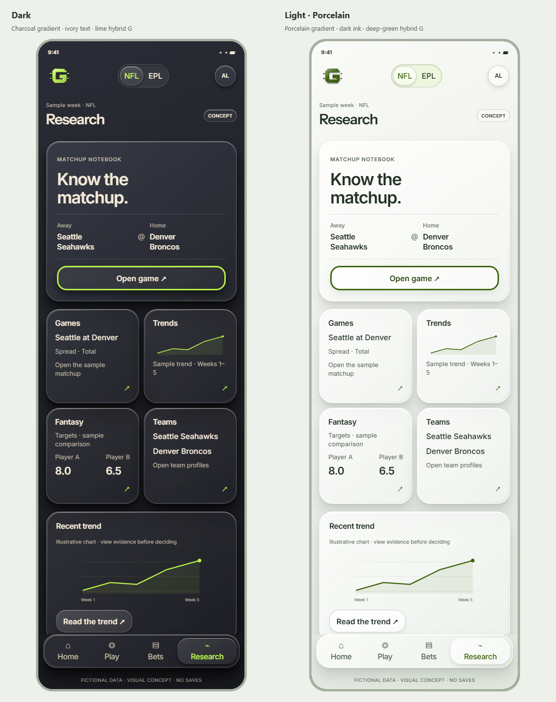

## Visual review progress — November 4, 2026

Sean requested a closer review after flagging the Research placeholder field,
missing team marks and sparse bubbles. **Home, Play and Bets overviews are
reopened in both themes**, with Research concerns still unresolved. Prior yes
acknowledgments remain in [acceptance history](selected-system-review.json), not
current completed sign-off. Chosen style recipes remain the starting point.
Sean confirmed useful miniature content previews; the implemented revision
is now ready for fresh review. Metadata scope and Brand QA passed. Visuals and production
are unchanged; whole-project completion and deferred work remain open.

## Selected dark + Porcelain across primary screens and layers — November 4, 2026

Sean authorized cross-screen review after selecting the Porcelain light base.
The [live paired review](selected-system-review.html) aligns dark and light
previews using six screen tabs and a layer selector. It covers Home, Play,
Bets, Research, EPL and Account: six primary views plus twenty available detail
states (26 pairs / 52 themed frame views). The [overview gallery](selected-system-overview.html)
shows browser captures of all six primary pairs and links back to each live view.
[Source manifest](selected-system-review.json) maps exact previously selected
dark recipes and the current Porcelain/light-adaptation recipes. No whole-app
approval or production acceptance is inferred.

Details include existing game/draft/score/league views, ticket/tracking/
recommendation layouts, Research lists/chart/table views, EPL drafting and
confirmation, and account/reminder sample states. The review reuses existing
fictional fixtures and click handlers; it does not build functional product
features. Existing awards/avatar/team/logo/icon work remains deferred. Screen
and layer controls align both phones; users can explore inside each separately
and use the parent controls to realign. Each frame uses a fixed device height
with flexible internal scrolling so navigation fits. Table rows are 16px,
headers 13px, inside named keyboard-focusable overflow regions in this review.

Optional notes are scoped to screen/layer, saved locally and exported as a
versioned JSON review file. They are not account data, approval or a release.
URL screen/layer parameters are validated against the manifest. The gallery is
a static browser-capture overview; the paired page is the interactive review.

Chromium verified all six screen pairs at 320/390/768/1440 (24 layout cases / 48
frames), with matching content, selected theme recipes/logos, card geometry,
internal navigation fit and no page/frame horizontal overflow. All 26 paired
states opened correctly (52 themed views); notes persisted after reload,
exported JSON content was verified, and a Research/fantasy deep link worked.
Table font sizes/region semantics were verified; the gallery loaded all six
captures without overflow at four widths. No JavaScript errors were observed.
All primary captures were reviewed through the gallery, with Home/Bets/Account
also inspected at full size. Exact source recipes, HTML IDs/local links, syntax,
export metadata and Brand QA passed. These are bounded mockup checks, not a
comprehensive accessibility audit or physical-device/hosted acceptance.
Production code/assets/tokens, frozen tracker and deferred scope are unchanged.
Cross-screen visual sign-off and whole-project completion remain pending.

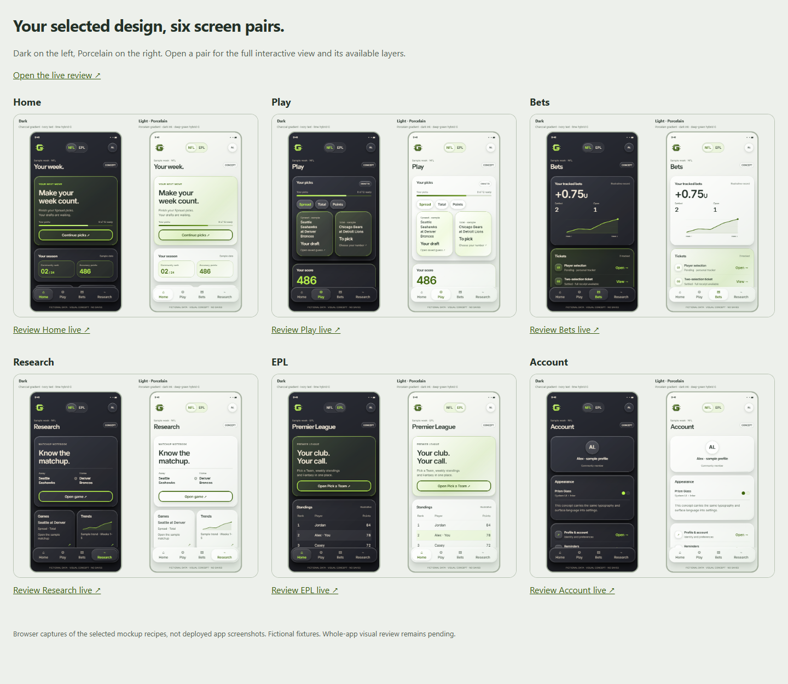

## Selected light background: 02 Porcelain glass — November 4, 2026

Sean selected **02 / Porcelain glass** from the Research comparison. The
[exact selection](light-mode-options.json) uses base `#E9ECE8` and
`linear-gradient(150deg,#FAFBF6,#E9ECE8 55%,#E0E7DE)`. [Owner preferences](prism-owner-color-preferences.json)
resolve the prior 02/04/05 background shortlist. The shared dark-ink/deep-green
logo/light-glass adaptations remain the preview references for cross-screen
review, not a separate claim of final app-wide approval. Metadata consistency
and Brand QA passed; reviewed visuals are unchanged. Cross-screen review,
production integration, whole-project completion and deferred work remain open.

## Research comparison for light shortlist 02 / 04 / 05 — November 4, 2026

Sean shortlisted Porcelain (02), Pale sage (04) and Silver mist (05), asked how
to decide, and agreed to compare the same denser Research screen. The [three-way
Research board](light-research-comparison.html) holds content, type, glass,
logo and accents identical so the background undertone is the comparison.
No option or light logo adaptation is selected. [Metadata](light-research-comparison.json)
retains original option numbers and the exact shared source recipes.

The comparison-only Research composition reuses the existing fictional Player
A/B usage values and illustrative trend vector from `app.js`; it does not alter
production Research, add live research, projections or sportsbook quotes. Table
values and row labels are 16px; headers/caption and external chart labels are
13px. Tiny vector text labels are replaced with native Week 1/Week 5 labels.
A named, keyboard-focusable native table scroll region contains narrow-width
overflow. The existing game-action button node is moved into the composition,
preserving its native bound handler. Opening details/Back or leaving/returning
to Research restores the comparison consistently.

Chromium checked three frames at 320/390/768/1440: identical table/chart/card
recipes, three distinct backgrounds, matching light logo and text, correct
reading sizes, table caption/region, no page/frame horizontal overflow, and
fitting navigation. Each preview passed game-details/Back and Home/Research
round trips. No JavaScript errors were observed. Source option/recipe consistency,
local references, syntax and Brand QA passed. The final desktop capture was
inspected. This is bounded mockup verification, not independent device acceptance
or a full accessibility audit. Dark selections, production and deferred scope
remain unchanged.

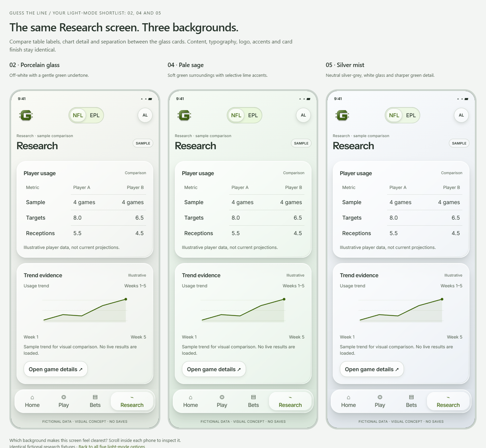

## Five light-mode alternatives — November 4, 2026

Sean agreed to compare light-mode options next. The [five-option board](light-mode-options.html)
shows Arctic glass, Porcelain glass, Warm ivory, Pale sage and Silver mist.
The first two revisit his earlier Arctic/Porcelain interests; no current light
option is selected. Shared floating-glass geometry, 18px blur, 28px corners,
selective lime action/stat accents, typography and transparent outlined button
family carry across the five. Dark ink replaces dark-mode ivory on light
surfaces. Dark green supplies readable labels, key figures, progress and outlines;
logo-lime remains in the surface tints. [Exact recipes](light-mode-options.json)
record the proposed adaptation and source mapping.

The [proposed deep-green hybrid SVG](logo-hybrid/light-deep-green.svg) retains all
paths, masks, grain and lighting from the selected dark logo, remapping only
base-derived gradient colors to existing light-theme green `#3B6309`. This is a
light-surface candidate, not a newly selected logo or a change to dark mode.
The dedicated light bridge does not alter earlier dark previews. Fixed-height
phone frames use flexible scrollable content so navigation fits without a dark
blank strip beneath the light scene.

Chromium verified five widths (320/390/768/1440/1920), five distinct backgrounds,
loaded adapted logos, light scheme, shared readable text/accent, selected card
geometry/blur, no page/frame horizontal overflow and fitting navigation/device
height. Thirty screen/light-option combinations retained the theme; all five
Home actions opened Play. The approved dark preview retained ivory and the lime
SVG in a regression check. No JavaScript errors were observed. Source checks
verified identical logo paths/masks/grain, local references and metadata.
Forty-five specified text/accent-to-gradient-endpoint pairs meet 4.5:1; this is
not a comprehensive audit of translucent glass or logo specular highlights.
Syntax and Brand QA passed; the final board capture was inspected. Transparency/
forced-color fallbacks were source-reviewed, not separately emulated.
Production code/assets/tokens and deferred follow-up remain unchanged.

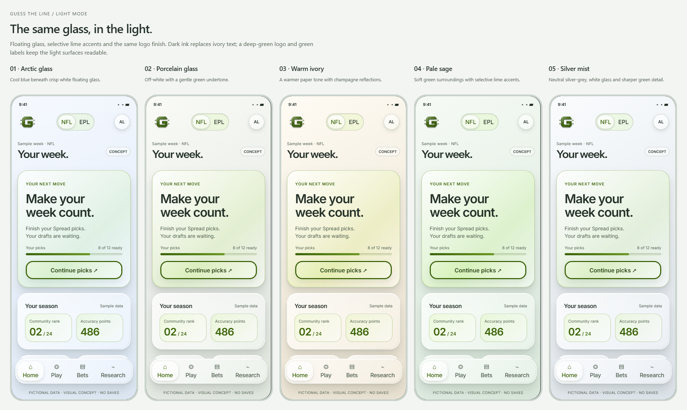

## Selected refined lime emphasis — November 4, 2026

Sean confirmed that the [lime-priority Home/Play preview](lime-priority-preview.html)
looks good. [Selection metadata](lime-priority-preview.json) now records exact
logo lime for action cards and key rank/accuracy stats, neutral supporting
floating cards, retained charcoal gradient/ivory text/hybrid logo, and the
transparent outlined primary shown. This supersedes the pending-refinement
status below and refines the earlier raw selective-color study. Metadata
consistency and Brand QA passed; reviewed visuals are unchanged. Remaining
screen/light-mode review, whole-project completion, production integration and
deferred follow-up are not established by this selection.

## Selective logo-lime emphasis on actions and key stats — November 4, 2026

Sean preferred Selective color, clarified the accent should match the bright
lime of his logo rather than forest green, and specified action cards plus key
stats such as rank and accuracy. The [Home/Play preview](lime-priority-preview.html)
uses the exact logo lime `#B8F34B` at varying transparencies: a lime face/edge on
action cards, lightly tinted rank/accuracy tiles and lime key figures. Supporting
cards and ordinary navigation retain neutral floating glass. Ivory reading text,
charcoal gradient, selected hybrid SVG and card geometry remain fixed. The
existing transparent-primary/3px-lime-outline recipe is retained.

[Exact settings and scope](lime-priority-preview.json) distinguish the requested
emphasis from a final visual selection. The bounded action selectors cover the
Home next-action hero, Play draft/pick tiles, the tracking action panel and EPL
pick-a-team panel. Stat accents target Home rank/accuracy and the Play score.
Ordinary research/navigation cards, status semantics and fixtures do not change.
The preview frames are taller to show highlighted and quiet cards together.
No separate card colors or unrelated accent hues were introduced.

Chromium verified four widths (320/390/768/1200), selected logo/text/geometry,
page/frame overflow and navigation fit. Computed Home rank/accuracy and Play
score colors match logo lime; action surfaces differ from the untouched quiet
cards/pick-container. Twelve screen/frame combinations retained the design and
the Home primary action opened Play. No JavaScript errors were observed.
JavaScript syntax, local references, metadata, exact source recipe consistency
and Brand QA passed. The final Home/Play capture was visually inspected after
font readiness. Reduced-transparency/forced-color styles were source-reviewed,
not browser-emulated; this is not full accessibility/device acceptance.
Refined visual sign-off, production integration and deferred follow-up remain open.

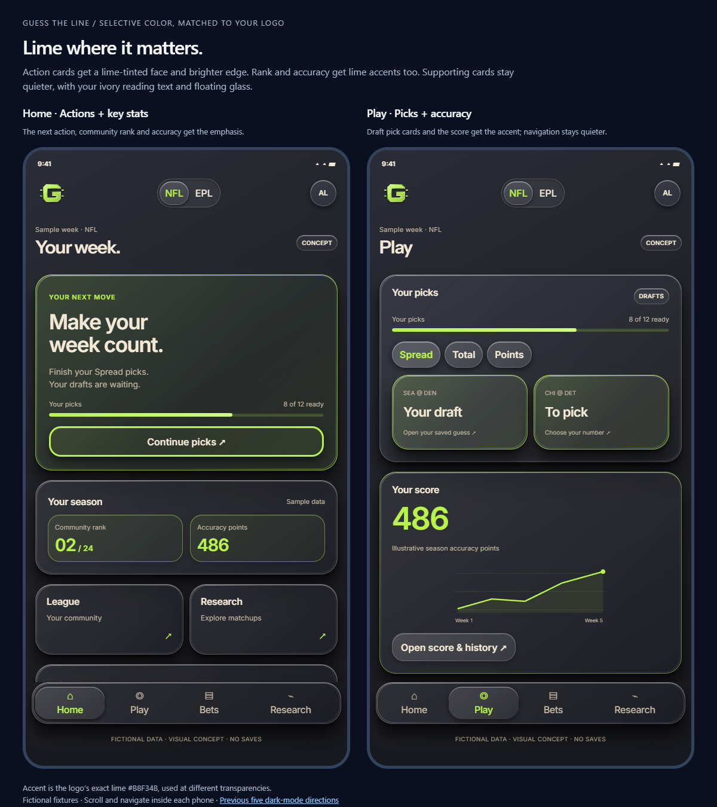

## Five directions for a richer dark mode — November 4, 2026

Sean felt the neutral/transparent direction was becoming too grey and accepted
five visual approaches: [Forest glass, Midnight glass, Warm graphite, Prism
edges and Selective color](dark-character-options.html). These are exploratory
alternatives, not replacements of earlier selections. All retain exact selected
lime hybrid logo, ivory main/secondary text, charcoal base, font and floating-glass
geometry (28px corners, 18px blur, selected gloss/shadow and spacing). Tints,
reflections and primary-action presence vary. Midnight/warm add cool/warm dark
background undertones; Prism keeps neutral cards with colored edge reflections;
Selective color keeps supporting cards neutral and colors the hero and primary
button. Dark label text is retained on the bright lime primary in option 05.
[Exact recipes](dark-character-options.json) preserve all settings.

Card/metric tints and the selective green hero were kept dark to protect the
selected ivory labels. Tint is decorative, not a semantic result/status change.
No direction or button-fill change is selected. This does not start deferred
avatar/team-mark/icon/award work or alter production code/tokens/assets.

Chromium checked all five frames at 320/390/768/1440/1920: no page/frame overflow,
visible navigation, loaded selected logos, fixed text/base/geometry/blur, and
five distinct edge/hero recipes. Thirty screen/direction combinations retained
their material and button overrides. All five Home actions opened Play. No
JavaScript errors were observed. JavaScript syntax, local references, metadata
and source geometry/material consistency passed, as did Brand QA. The final
Home capture was inspected after waiting for frame fonts and settled rendering.
Reduced-transparency/forced-color rules were source-reviewed, not emulated.
These checks do not establish full accessibility or physical-device acceptance.

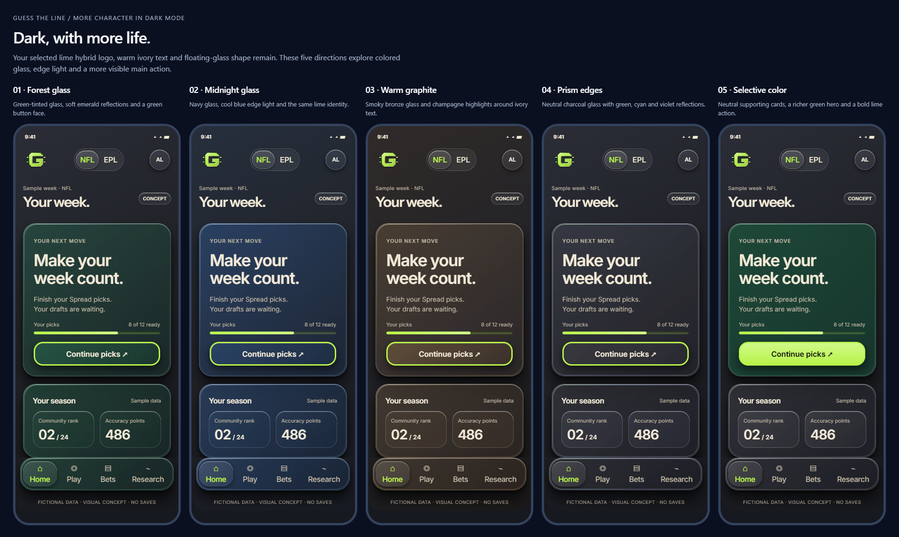

## Frosted button refinement: transparent face, bold lime outline — November 4, 2026

Sean chose the frosted-glass button family and requested a transparent face with
a bolder green outline. The [before/after preview](button-transparent-lime.html)
retains the exact selected logo/background/text/floating-card design. The revised
primary has no fill (`transparent`, computed alpha zero), no background image or
gloss wash, a full 3px `#B8F34B` border, ivory label, retained 20px corners and
18px backdrop blur. The existing frosted-family secondary styling is retained.
[Exact recipe](button-transparent-lime.json) records the request; the implemented
3px weight is shown for review, not treated as final visual sign-off.

The shared action bridge accepts optional backdrop filtering and defaults to
`none`, preserving earlier family appearances. Chromium verified four widths
(320/390/768/1100), transparent computed face/no image/no shine, exact border,
label/radius/blur, loaded selected logos, identical selected backgrounds/cards,
no page/frame overflow and fitting navigation. Twelve screen/column combinations
retained the recipe. The revised Home action opened Play and its keyboard focus
outline remained visible. The original frosted preview retained no backdrop
filter. No JavaScript errors were observed. Syntax, local references, metadata,
selected-card consistency and Brand QA passed; the desktop capture was inspected.
These are bounded mockup checks, not full accessibility/device acceptance.
Production and deferred follow-up are unchanged.

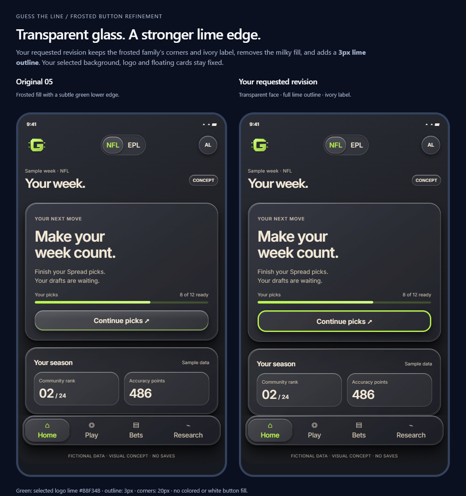

## Five button styles on the selected design — November 4, 2026

Sean requested five button styles with the selected background, ivory text,
lime logo and floating glass cards. The [button board](button-style-options.html)
compares classic lime pill (unmodified reference), glossy bubble, soft rectangle,
lime outline and frosted glass. Only primary action material/shape/edge/text-on-fill
and secondary action corners/shadows vary. The selected floating-card recipe,
charcoal gradient, general ivory text, hybrid SVG, font, spacing and navigation
styling stay fixed. Dark text remains on bright lime; ivory is used on dark/clear
button faces. [Exact recipes](button-style-options.json) record all values.
No button style is selected.

The dedicated bridge reapplies skins after navigation and supplies keyboard
focus, pressed, hover, disabled, reduced-motion and forced-color styles for the
four new families. Chromium verified all five frames at 320/390/768/1440/1920,
including no page/frame horizontal overflow, fitting navigation, fixed selected
logo/colors/cards, five distinct button appearances and 48px primary height.
Thirty screen/style combinations retained the selected design. All five Home
primary actions opened Play. Each of the four new primary styles showed its 3px
focus-visible outline through keyboard navigation. The 01 reference exactly
matches the primary button in selected card option 05. No JavaScript errors were
observed. Responsive state was tested in Chromium; reduced-motion, disabled and
forced-color rules were source-reviewed, not separately browser-emulated.

JavaScript syntax, local HTML references, source recipe consistency and Brand QA
passed. The desktop comparison was visually inspected. This is not a full
accessibility audit or physical-device acceptance. Production code/tokens/assets
and deferred follow-up are unchanged.

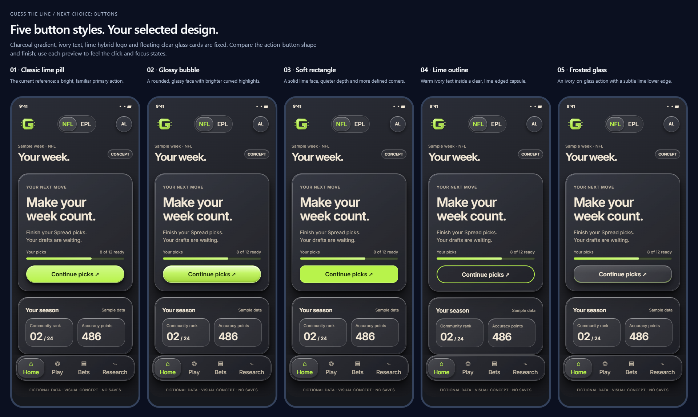

## Selected card finish: 05 Floating clear glass — November 4, 2026

Sean selected **05 / Floating clear glass**, resolving the card-finish review.
Use the exact [selected recipe](glass-card-options.json): light clear tint,
18px blur, 28px corners, restrained gloss and deeper shadow separation, including
the navigation glass shown in the option. His selected charcoal gradient,
ivory text and lime hybrid logo remain fixed. [Owner preferences](prism-owner-color-preferences.json)
record these choices together. Earlier unselected-card status below is historical.
Metadata consistency and Brand QA passed; reviewed visuals are unchanged.
Remaining control/light-mode choices and whole-project completion remain open;
production integration and deferred follow-up have not started.

## Next decision: five glass card finishes — November 4, 2026

After selecting the combined dark direction, Sean asked to continue. The
[five-card-finish board](glass-card-options.html) compares current glass (the
unmodified reviewed reference), bubble glass, frosted glass, smoked glass and
floating clear glass. The selected charcoal gradient, ivory main/secondary text,
lime hybrid logo, typography, layout spacing and control colors stay fixed.
Only card material, corners and elevation change. The same treatment carries
into the navigation glass; no icons, features or functional behavior change.
[Exact recipes](glass-card-options.json) record backgrounds, borders, blur,
shadows, gloss and radii. No card finish is selected.

The dedicated bridge styles only this review's frames and reapplies the material
after screen changes. It includes reduced-transparency and forced-color styles;
these fallbacks were source-reviewed, not independently browser-emulated.
Chromium checked all five frames at 320/390/768/1440/1920: no page/frame
horizontal overflow, visible navigation, exact selected text/logo/accent,
identical phone backgrounds and five distinct computed card surfaces. Thirty
screen/finish combinations retained appearance across all six areas. The 01
card background matches the previously reviewed combined preview exactly.
No JavaScript errors were observed. JavaScript syntax, source metadata, local
HTML references and Brand QA passed. The desktop capture was visually inspected.
These are mockup checks, not full accessibility or physical-device acceptance.
Production code/tokens/assets and deferred follow-up remain unchanged.

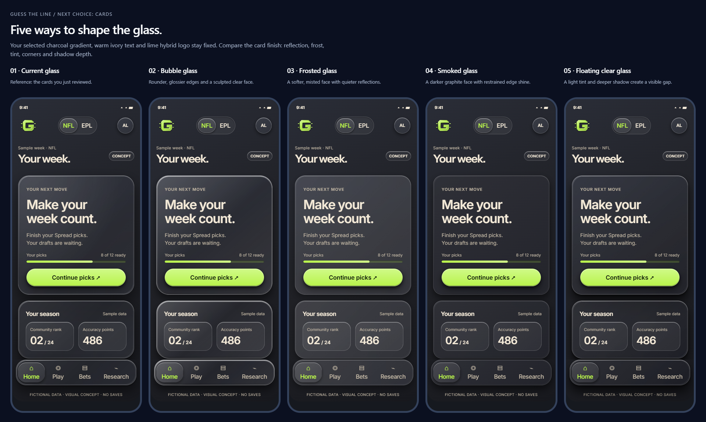

## Selected combined dark direction — November 4, 2026

Sean confirmed the **middle combined preview**: 02's subtle charcoal gradient
and 04's warm ivory main/secondary text with the already selected lime hybrid G.
The [exact selection](charcoal-ivory-combination.json) and [owner preferences](prism-owner-color-preferences.json)
record base `#202126`, the 150-degree charcoal gradient, main `#F3E9D7`, secondary
`#C4B9A6` and selected `logo-hybrid/lime.svg`. This supersedes review-pending
statuses in the earlier entries below. The comparison itself stays as reviewed.
This records a dark background/text direction; it does not establish approval
of remaining card/control/light-mode decisions or whole-project completion.
Metadata consistency and Brand QA passed; reviewed visuals are unchanged.
Production integration and the deferred phase have not started.

## Combined preview: 02 gradient and 04 ivory — November 4, 2026

Sean shortlisted depth/text studies 02 and 04, asked which is better for users,
and agreed to see the proposed combination before choosing. The [three-column
comparison](charcoal-ivory-combination.html) shows original 02, the combined
preview, and original 04. The middle uses the exact 02 charcoal gradient with
04 main `#F3E9D7` and secondary `#C4B9A6` text. Card material, font, logo,
control colors and fictional fixtures are unchanged. The combined treatment is
requested for review, not selected or deployed. [Exact metadata](charcoal-ivory-combination.json)
records the source studies and shared selected logo.

Chromium verified four widths (320/390/768/1440), no page/frame horizontal
overflow, visible navigation, loaded selected logos, identical material/accent,
matching left/middle gradients and matching middle/right text colors. Eighteen
screen/column combinations retained those relationships during navigation.
No JavaScript errors were observed. Source metadata and local HTML references
were verified, the desktop capture was visually inspected, and Brand QA passed.
The earlier specified text-to-brightest-gradient endpoint calculations were
11.41:1 main and 7.09:1 secondary; these do not establish all translucent-card
contrast or user preference. No production or deferred-phase change occurred.

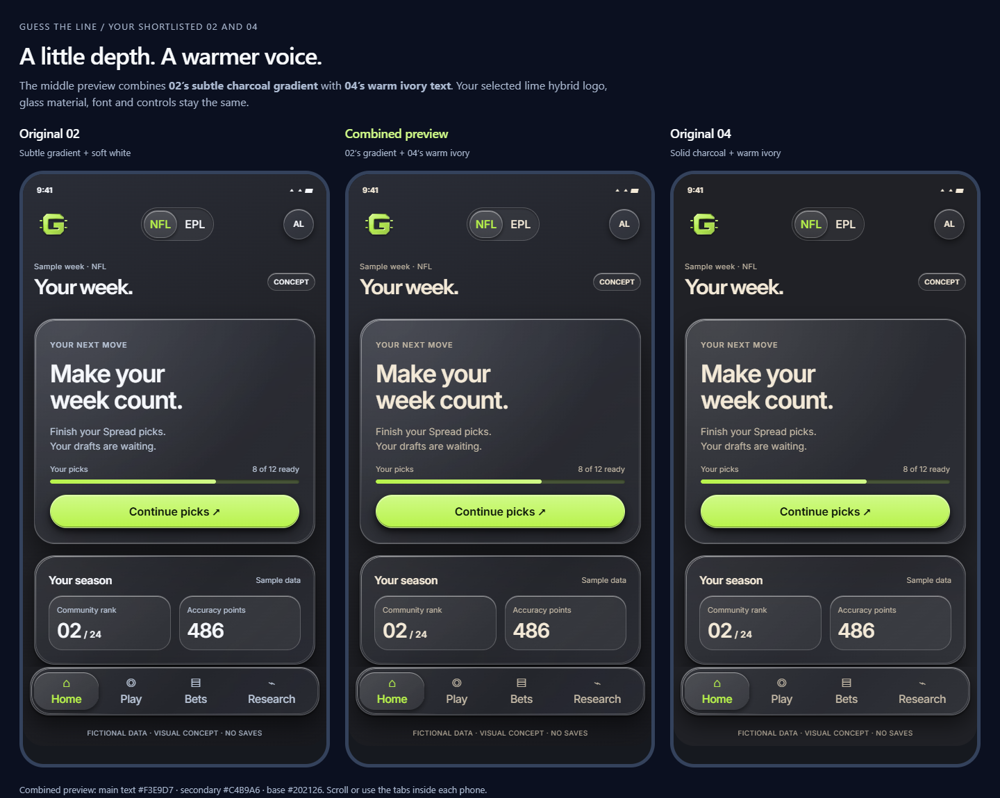

## Selected charcoal: ten depth and text studies — November 4, 2026

Sean selected background **01 / Obsidian charcoal** for dark mode, then asked to
compare solid charcoal, a subtle gradient and faint glow, plus more unique text
colors, in about ten examples. The [ten-option board](charcoal-depth-options.html)
uses the selected base `#202126` and exact selected lime hybrid SVG throughout.
Options 01–03 keep the same text pair and isolate depth. Options 04–10 explore
warm ivory, ice blue, pale sage, lavender, dusty rose, pale gold and soft copper
text pairs. Card material, font, logo, accent and fictional fixtures remain
consistent. No depth treatment or text pair is selected. This does not settle
light mode or select a new app accent/semantic color system.

[Exact settings](charcoal-depth-options.json) distinguish the three background
recipes and eight text pairs. Earlier 01–05 background numbers are separate from
this board's 01–10 numbers. The shared preview bridge accepts optional wash/text
attributes; its defaults preserve the earlier five-background comparison.

Chromium checked ten frames at 320/390/768/1440/1920 pixels, including loaded
selected logos, text colors, base color, page/frame overflow, navigation fit,
identical shared card/accent variables and the isolated 01–03 comparison.
Sixty screen/study combinations retained the logo, background treatment and
text overrides. The earlier five-background board retained solid backgrounds
and selected logos in a regression check. No JavaScript errors were observed.
Both rows were visually inspected. JavaScript syntax, HTML links/IDs, metadata,
and Brand QA passed. Twenty specified main/secondary text-to-base pairs meet
4.5:1; this is not a comprehensive composited-glass accessibility audit.
Production code/assets/tokens and deferred follow-up are unchanged.

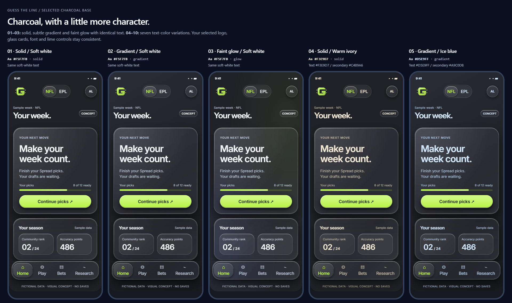

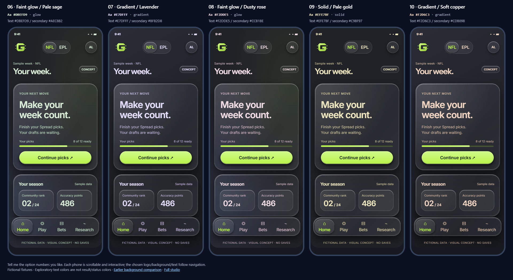

## App background comparison with selected logo — November 4, 2026

Sean next requested a few app backgrounds with his selected logo. The
[five-background board](app-background-options.html) shows Obsidian charcoal,
Midnight navy, Forest night, Deep petrol and Smoked plum. The first three reuse
backgrounds from previous palettes 12, 18 and 11; the other two explore dark
petrol/plum bases. These local option numbers 01–05 refer only to backgrounds,
not the previous full-palette board. No background is selected.

Every interactive Home mockup uses the exact selected `logo-hybrid/lime.svg`,
neutral glass variables, identical lime controls, text, layout and fictional
fixtures. Only the solid phone background changes; translucent cards naturally
show the base behind them. Choosing a gradient or approving a control/card
palette remains a separate decision. [Metadata](app-background-options.json)
records exact hex values and source mapping. Original review pages and production
code/assets/tokens are unchanged. Logo/background overrides follow navigation.

Chromium verified all five frames at 320/390/768/1440/1920 pixels: no page/frame
horizontal overflow, navigation fits the preview, selected logos load, solid
backgrounds stay distinct, and accent/card variables remain shared. Thirty
screen/background combinations (six areas times five backgrounds) retained their
selected logo, base and shared accent. No JavaScript errors were observed.
JavaScript syntax, HTML local links/IDs, metadata and Brand QA passed. The
five-phone Home capture was visually inspected. These are mockup checks, not
physical-phone acceptance. The deferred phase remains held.

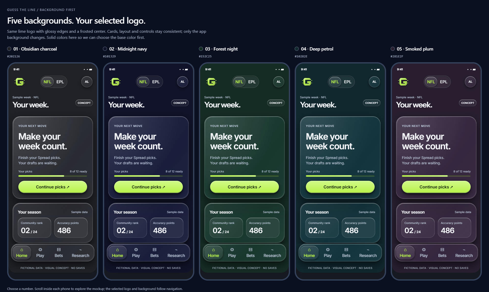

## Selected logo direction — November 4, 2026

Sean selected **01 / Current lime hybrid** after clarifying "original" as option
01 on this board, not the flat app mark. Use the [reviewed lime SVG](logo-hybrid/lime.svg)
as the selected direction: exact existing G shape, lime `#B8F34B`, glossy edges
and frosted center. [Selection metadata](logo-hybrid/manifest.json) records the
scope. The five other colors remain unselected. This supersedes the earlier
unapproved-hybrid status below; broader app palette and project completion
remain open. Production integration and deferred follow-up have not started.

## Glossy/frosted hybrid and additional colors — November 4, 2026

Sean shortlisted finishes **1 / Glossy glass** and **2 / Frosted glass** and asked
for a hybrid with glossy edges and a frosted center, keeping the same G and
current color while also adding colors. The [hybrid board](logo-hybrid.html)
retains current lime as option 01 and adds evergreen, ice blue, warm amber,
soft violet and rose quartz. Every version shares exact canonical G/hash paths,
fixed frontal orientation, lighting, size, grain seed and dark background.

Native SVG layers place the frosted face inside an eroded canonical-body mask,
leaving a glossy rim and reflective yard-line strokes. Reflections are confined
to the rim; fine grain and a broad diffuse wash sit in the center. Base colors
and the exploratory status are in the [manifest](logo-hybrid/manifest.json).
These are editable vector material concepts; no raster edit or production asset
replacement occurred. Finish shortlist is not final approval of the hybrid/color.

Chromium verified six options, all twelve large/header images loaded, identical
card backgrounds and no horizontal overflow at 320/390/768/1440 pixels. XML
checks verified canonical paths and stroke, correct base swatches, fixed view,
shared inset masks and noise seed, and no shape transforms for all six SVGs.
HTML local links and Brand QA passed. The desktop board was visually inspected.
The separate avatar/team-mark/icon/award phase remains held.

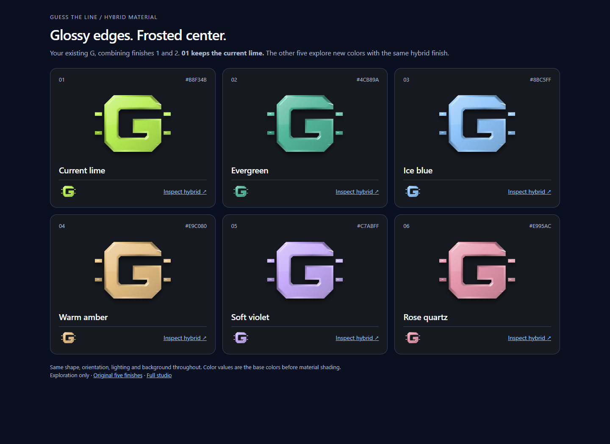

## Finish before color — November 4, 2026

Sean clarified that he wants to change the flat/2D appearance first. He explicitly
requested five finishes, including glossy glass, keeping the same G shape and
color for now. The [finish comparison](logo-finish-first.html) therefore supersedes
the color-first sequence. Options are glossy glass, frosted glass, polished
enamel, brushed metal and satin ceramic. Every preview uses current lime
`#B8F34B`, identical backgrounds, frontal orientation and sizing. Highlights and
shading vary with the material; they are not additional base-color proposals.

Native SVG gradients, lighting filters, clipped reflections and grain preserve
the exact canonical body/hash paths and hash stroke. This is editable vector
exploration, not raster editing. [Source manifest](logo-finishes/manifest.json)
records the method, swatch and filenames; standalone SVG links support closer
inspection. No new geometry, app tile or production asset was adopted.

Chromium checked all ten preview images loaded, five options, identical card
backgrounds and no horizontal overflow at 320/390/768/1600 pixels. XML/path
checks verified exact body/clip/hash geometry, stroke, base lime and viewBox for
all five vectors; HTML local links and Brand QA passed. The final desktop
capture was inspected after reducing the ceramic/frosted highlights to keep
materials distinct. These are material concepts, not physical renders or an
approved finish. The earlier color board remains provenance, not the next step.
The deferred phase remains held.

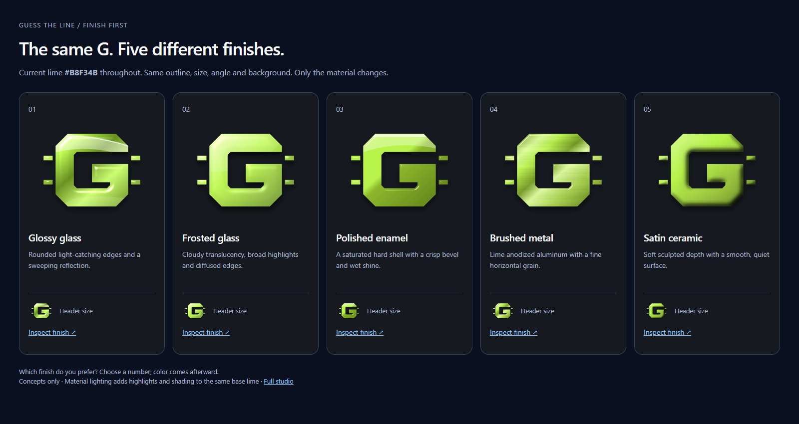

## Logo color first — November 4, 2026

Sean found the full customizer difficult to narrow down and chose to start with
logo color/style. He confirmed keeping the current G shape. The [five-color
comparison](logo-color-first.html) keeps the exact Balanced Yardline G geometry,
flat finish and identical dark surround at large and header sizes. Soft lime
and warm amber reuse options 18 and 12; mint, blue and violet are exploratory
hues under his existing authorization to explore new colors. This chooses
neither the app palette nor a finish. One next question: which logo color?

[Color metadata](logo-color-first.json) records exact swatches. Chromium verified
five choices/ten SVG marks and no horizontal overflow at 320/390/1400 pixels;
computed colors match the swatches. Source verification confirms every path
matches the approved SVG and that no gradient/effect was added. The desktop
capture was visually reviewed; Brand QA passed. No production asset changed.
The deferred avatar/team-logo/icon/award phase remains held.

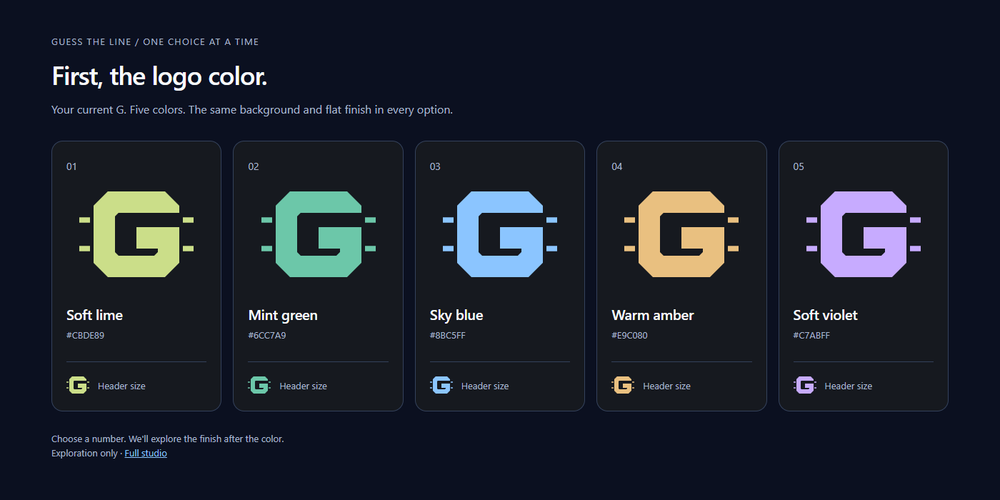

## Interactive Prism Glass customizer

Open the [live customizer](prism-customizer.html). Sean requested direct color
selection, background gradient on/off and additional style controls. The studio
previews Home, Play, Bets, Research, EPL and Account, including opened layers.
It offers background/card/accent/text colors, two gradient colors, strength and
angle; polished/frosted/clear/solid materials; opacity, blur, gloss, shadow,
corner radius and spacing; and system, rounded or editorial typography.

Dark and light configurations stay independent. Settings persist in this browser;
named designs contain both modes. Export/import transfers a versioned JSON file.
Storage is local, not account synchronization. The shortlist includes 12, 18, 11,
01 and 24; Sean likes only 18 and 24 from the additional round. The studio starts
from his previously stated 12-dark/01-light preferences. No final dark selection
between 12 and 18 has been inferred. All 24 starting palettes remain available.
Choosing a starting palette resets that mode's appearance to its preset.

Local Chromium verification: 26 targeted assertions passed for custom colors,
gradient off, independent modes, all six screens, child navigation, solid/clear
materials, radius, typography, named restore, export/import, invalid inputs,
reload persistence and layouts at 320/390/736/1440 pixels. Additional checks
confirmed gradient restoration, color-picker invalid-state recovery, and retained
appearance inside Research game and Account reminder layers. No JavaScript
errors were observed. Desktop dark and mobile dark/light captures were inspected.
Brand QA, JavaScript syntax and local HTML references/IDs were checked.
Contrast figures compare base text/background and button colors only; arbitrary
user colors and composited translucent surfaces require their own review.

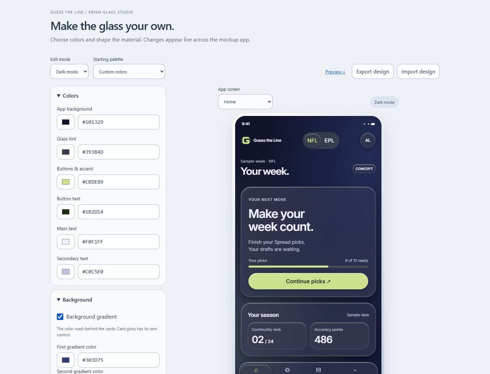

This is a coded visual prototype using fictional fixtures, not production UI or
functional betting/account verification. The requested colors/fonts are an
explicit exploration exception; production tokens and approved G geometry remain
unchanged. Approval and the deferred avatar/logo/icon/award phase remain pending.

## More unique palettes and an optional card-color experiment

Sean prefers original **12 / Obsidian Amber for dark mode** and **01 / Arctic
Blue for light mode**, and also likes **11 / Forest Night**. These remain the
reference choices and their numbers have not changed. He clarified that
"separate colors" meant "unique, different, new". He additionally authorized
seeing different colors per card; that is an optional experiment, not an
interpretation of the original request or a selected design.

Open [twelve additional combinations, numbered 13–24](prism-new-colors.html).
Ten dark and two light combinations emphasize darker surrounds, contrasting
accents, clearer edges and shadow gaps. Typography, layout and the glass
material remain consistent. Original options 01–12 remain on the first board.

The **Different colors per card** checkbox switches a presentation-only view.
The [side-by-side experiment on favorites 12, 01 and 11](prism-card-color-comparison.html)
compares unified and individually tinted cards. Notes concern each palette
across both views; exports include the active card-color mode. The tint
categories are decorative, not a new result/status color system.

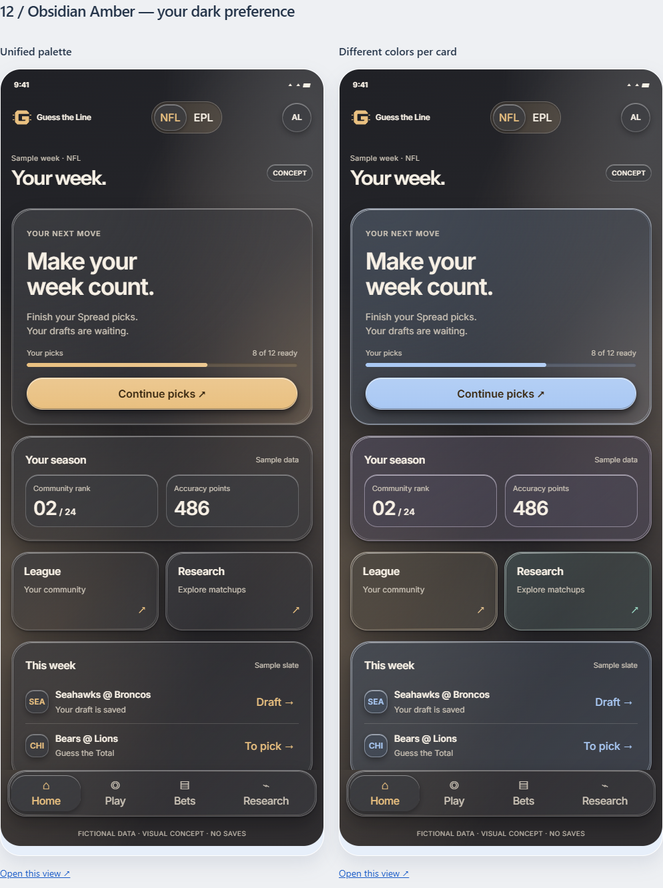

[New unified palettes](previews/prism-new-color-combinations.png) ·
[New palettes with varied cards](previews/prism-new-colors-varied-cards.png).

| Number | Additional scheme | Mode |
| --- | --- | --- |
| 13 | [Ink & Cobalt](prism.html?style=prism&palette=ink-cobalt) | dark |
| 14 | [Carbon & Copper](prism.html?style=prism&palette=carbon-copper) | dark |
| 15 | [Petrol & Coral](prism.html?style=prism&palette=petrol-coral) | dark |
| 16 | [Forest & Orchid](prism.html?style=prism&palette=forest-orchid) | dark |
| 17 | [Burgundy & Ice](prism.html?style=prism&palette=burgundy-ice) | dark |
| 18 | [Midnight & Lime](prism.html?style=prism&palette=midnight-lime) | dark |
| 19 | [Slate & Apricot](prism.html?style=prism&palette=slate-apricot) | dark |
| 20 | [Espresso & Turquoise](prism.html?style=prism&palette=espresso-turquoise) | dark |
| 21 | [Graphite & Cherry](prism.html?style=prism&palette=graphite-cherry) | dark |
| 22 | [Indigo & Gold](prism.html?style=prism&palette=indigo-gold) | dark |
| 23 | [Ice & Pomegranate](prism.html?style=prism&palette=ice-pomegranate) | light |
| 24 | [Porcelain & Evergreen](prism.html?style=prism&palette=porcelain-evergreen) | light |

Verification: 144 embedded palette/screen/card-mode combinations and 288 focused
palette/screen/card-mode/width combinations at 320/390px passed the targeted
layout checks. All six favorite anchor/mode views rendered. Original option
numbers, round-specific board counts, favorite/note reload persistence and a
round-2 export's ID/number/mode were checked. Sixty new specified token pairs
meet 4.5:1; this is not a complete composited-glass accessibility audit. New
palette and card-comparison captures were visually inspected. No production
implementation or optional card-color adoption is inferred.

## Prism Glass — twelve color schemes

Sean requested at least ten color schemes while retaining the refined glass
style. Open [the 12-palette comparison board](prism-colors.html). Seven light
and five dark palettes share the same material, typography and layouts across
Home, Play, Bets, Research, EPL and Account, including deeper layers.

Use the Screen selector to compare the same area across twelve palettes. Open
any palette to navigate its full mockup or switch colors. Save palettes and notes
on the comparison board, then export gtl-prism-color-favorites.json. A focused
palette review exports gtl-prism-color-review.json with its current palette ID
and notes. Notes stay attached to their palette when switching or reloading,
and are shared between the focused review and the comparison board. These remain review preferences, not production approval.

| Number | Scheme | Mode |
| --- | --- | --- |
| 01 | [Arctic Blue](prism.html?style=prism&palette=arctic) | light |
| 02 | [Pearl Graphite](prism.html?style=prism&palette=pearl) | light |
| 03 | [Champagne](prism.html?style=prism&palette=champagne) | light |
| 04 | [Sea Glass](prism.html?style=prism&palette=sea) | light |
| 05 | [Peach Coral](prism.html?style=prism&palette=coral) | light |
| 06 | [Rose Quartz](prism.html?style=prism&palette=rose) | light |
| 07 | [Lavender Mist](prism.html?style=prism&palette=lavender) | light |
| 08 | [Sapphire Night](prism.html?style=prism&palette=sapphire) | dark |
| 09 | [Midnight Teal](prism.html?style=prism&palette=teal) | dark |
| 10 | [Aubergine](prism.html?style=prism&palette=aubergine) | dark |
| 11 | [Forest Night](prism.html?style=prism&palette=forest) | dark |
| 12 | [Obsidian Amber](prism.html?style=prism&palette=obsidian) | dark |

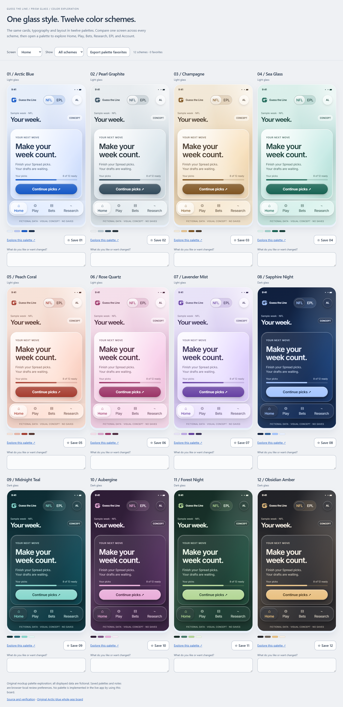

Complete palette tokens are in prism-palettes.json, with CSS and browser data
exports. Color overrides include atmospheric backgrounds, frosted surfaces,
edge highlights, text, buttons, graphs, tables, navigation and opened layers.
No production app tokens are changed.

Local checks: 72 embedded palette/screen combinations, 144 focused palette/
screen/width combinations at 320/390px with no detected horizontal overflow,
selected-token application after navigation, a dark game layer, favorites and
notes reload persistence, light/dark/favorites filters, and both export filenames.
All twelve Home previews were visually inspected. Sixty specified token pairs
(body/base, muted/base, accent/base and both primary-button gradient endpoints)
meet 4.5:1; this is not a comprehensive audit of composited glass backgrounds.
No palette has been selected or deployed.

## Prism Glass — refinement round 2

Sean selected Prism Glass to refine first: "Make the cards glossier and more
Apple-like, and carry that style across the whole app." This is a mockup
refinement request, not final brand selection or production implementation.

Open [the six-screen Prism board](prism-board.html) or the
[focused Prism review](prism.html). The shared material is applied to all six
primary areas and their opened layers: double-edge highlights, translucent
panels, a brighter glazed cobalt action, softer depth, frosted segmented controls
and floating navigation. Typography now uses system UI (the Apple system face
where available) with Inter/Segoe UI fallbacks. No font binaries are redistributed.

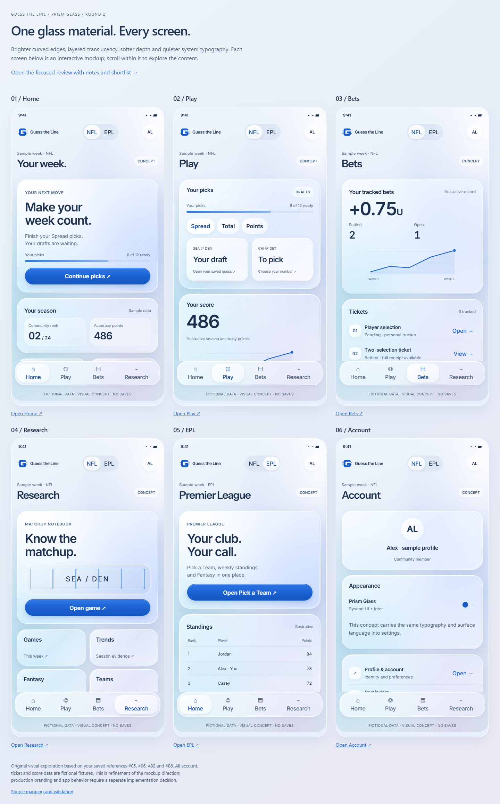

[Full Home capture](previews/prism-refined-home.png).

The new CSS is scoped to Prism; other style directions retain their systems.
The eight-direction gallery now shows the refined Prism. Older eight-style
comparison PNGs below preserve round 1, before this refinement.

Targeted round 2 verification: 18 primary screen/width combinations across
320/390/736px, six embedded screens with no horizontal document overflow, four
representative layers (game/Back, Fantasy, EPL recorded-team confirmation,
reminders), note/shortlist reload persistence and export. Original comparison
still renders eight directions. The Home and six-screen captures were visually
inspected. JavaScript syntax, local links and Brand QA pass. This does not
establish live app integration or a comprehensive accessibility audit.

Sean requested 5–10 genuinely different styles across the whole app, based on
his 25 saved references. He explicitly authorized exploring new colors and
typography. These eight original directions are that visual exploration.
They are new coded mockups, not a gallery of existing GTL screens.

Open [the interactive review](index.html). The Screen selector compares Home,
Play, Bets, Research, EPL and Account across all eight. The Direction selector
opens a larger view of one style. Primary buttons, app tabs and the account/sport
controls navigate the mockups. Some content opens illustrated deeper layers.
[First-look overview](overview.html) crops each Home viewport for comparison;
use the full review for complete content.

## Review behavior and limits

- 48 primary screen concepts plus representative detail/state previews.
- Notes and shortlists persist locally in this browser. Export review downloads
  gtl-style-direction-review.json. These are preferences, not production approval.
- Game, Fantasy, Pick a Team and reminder states are visual fixtures. Generic
  deeper layers demonstrate the visual language; they are not full feature builds.
- All account names, points, tickets and player stats are fictional. No current
  bookmaker quote, player pick or private production data is included.
- No odds, model percentages, authenticated reads, subscriptions, actual pick
  submission or production integration is claimed by these screens.

## Source mapping

The reference numbers below match Sean's exported favorites and the
[87-reference library](../style-references-2026-11-04/REFERENCES.md).
All 25 selected IDs map to a direction. Original reference artwork was inspected
locally for #05, #06, #11, #23, #25, #33, #40, #47 and #56. Other selections
provide additional direction context; no comprehensive visual audit is claimed.
Original imagery, logos and athlete artwork are not copied into the mockups.

| Direction | New type | Palette / structure | Saved references |
| --- | --- | --- | --- |
| 1 · Prism Glass | System UI + Inter (round 2) | Airy glass, icy color, luminous edges. | [#05](https://dribbble.com/shots/15816152-Messanger-Chat-App-With-Glassmorphism-Effect), [#06](https://dribbble.com/shots/15073946-Smart-Home-Manager-App), [#82](https://www.behance.net/gallery/227826125/Liquid-Glass-UI-Design-ios-26-Apple-Liquid-Glass-UI), [#86](https://x.com/proskuaaa/status/2083260471302365520) |
| 2 · Pearl Touch | Nunito Sans | Soft relief, circular controls, quiet blue. | [#28](https://dribbble.com/shots/10725826-Neumorphism-Soldo-mobile-app), [#29](https://dribbble.com/shots/11443127-iOS-Neumorphism-Concept), [#30](https://dribbble.com/shots/22289315-Alarmly), [#31](https://dribbble.com/shots/25716286-Minimal-Futuristic-Music-Player-UI) |
| 3 · Paper Cut | Space Grotesk + IBM Plex Mono | Hard edges, bold ink, graphic lilac. | [#23](https://dribbble.com/shots/21692566-Neo-Brutalism-Cryptocurrency-Trading-and-Assets-Dashboard) |
| 4 · After Hours | Space Grotesk + Space Mono | Plum-black, hot magenta, technical type. | [#25](https://dribbble.com/shots/25514281-3D-Neumorphic-Design-Financial-Wallet-Mobile-App), [#33](https://dribbble.com/shots/27362502-AI-Trading-Mobile-iOS-App-Design), [#37](https://dribbble.com/shots/27242702-Fitness-App-Dashboard-UI-Design-Health-Tracking-Mobile-App) |
| 5 · Orbit Bento | Plus Jakarta Sans + DM Sans | Asymmetric modules, citrus, confident numbers. | [#40](https://dribbble.com/shots/25093522-Crypto-Wallet-Mobile-App-Bento-Grid), [#41](https://dribbble.com/shots/26828063-Crypto-Dashboard), [#43](https://dribbble.com/shots/25860105-Bento-Grid-Rive-animations), [#45](https://dribbble.com/shots/26434437-Bento-Cards), [#46](https://dribbble.com/shots/14234337-JUZZ-UP-mobile-card-ui) |
| 6 · Matchday | Oswald + Barlow | Coral, charcoal, oversized sports headlines. | [#47](https://dribbble.com/shots/16248566-Fantasy-Football-App), [#48](https://dribbble.com/shots/21459387-Fantasy-Cricket-App-Sports-Fantasy-App), [#51](https://dribbble.com/shots/25330262-UI-UX-Design-for-Sports-SaaS-Mobile-App), [#52](https://dribbble.com/shots/25571081-Sports-Betting-App-NBA), [#54](https://dribbble.com/shots/2073684-Fantasy-football-dashboard) |
| 7 · Summit | Instrument Sans + DM Serif Display | White space, editorial type, orange signals. | [#11](https://dribbble.com/shots/24562076-Slope-Mobile-iOS-App-Design-Concept) |
| 8 · Sunday Grove | DM Sans + Fraunces | Warm cream, sage, expressive serif. | [#56](https://dribbble.com/shots/26990857-Holistic-Health-Nutrition-Sustainable-Wellness-UI), [#57](https://dribbble.com/shots/25770562-Wellness-Meditation-Mobile-App-UI-UX-Design) |

## Explicit exploration exception

The brand guide and design/tokens.json were read before creating these assets.
Sean's November 4 instruction authorizes new colors and typography for these
mockups. Each direction defines its own scoped CSS color/type variables; this
exception applies to the design artifact only. The selected Yardline G geometry
is retained. Existing app tokens and production branding are not changed.
Fonts use the Google Fonts stylesheet with local fallbacks; font files are not
redistributed. Typography is exploratory and has not received final selection.

## Local verification

- JavaScript syntax and repository Brand QA.
- Browser: 96 primary screen/width combinations (8 styles × 6 areas × 320/390px),
  plus 12 comparison view/width combinations (6 areas × 736/1600px); no detected
  horizontal overflow in the checked controls/panels or document.
- 32 detail checks across styles: Research game/Back, Fantasy table, EPL recorded
  team confirmation and reminder enabled preview.
- Notes and shortlist reload persistence; export download filename.
- Original 8-style Home overview visually inspected; the sports panel contrast
  and narrow-header issues identified there were corrected before delivery.

This is targeted visual/mockup QA, not a full accessibility audit or live app
acceptance. Static captures are in previews/. Raw capture and CLI evidence are retained
under ignored .local helpers in the task checkout. No test credentials are involved.

## Round 1 comparison previews — before Prism refinement

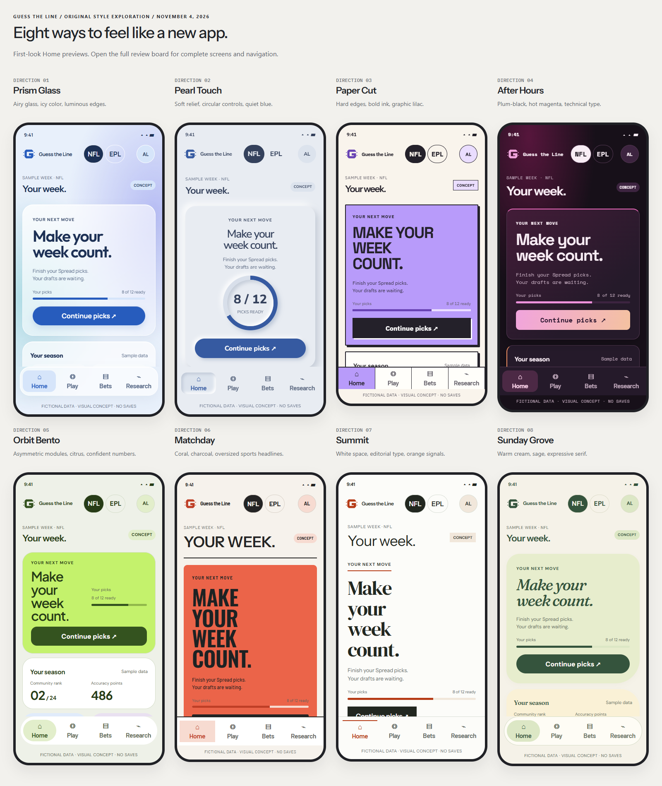

[Bets comparison](previews/bets-overview.png) · [Research comparison](previews/research-overview.png)
