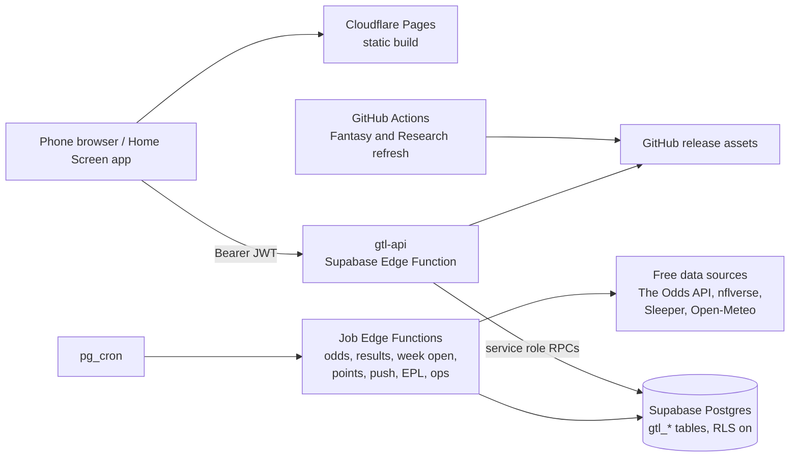

# Guess The Line — architecture

Owner: Sean Balsiger · Version 1 · November 3, 2026

This file maps how the system is built today, at `main` `0f0b5f44`. It describes the code, not the product rules
([RULES.md](RULES.md), [DECISIONS.md](DECISIONS.md)) or what is live
([COMPLETION_REGISTER.md](COMPLETION_REGISTER.md), the dated `RELEASE_*.md` records). When code and this file
disagree, the code wins: fix this file in the same PR.

## Frontend

- **Build:** Vite 7 and React 19. `vite.config.js` uses `root: 'web'`. `npm run build:cloud` writes
  `.local/cloud-dist`, which `wrangler.jsonc` publishes as the Pages project `guess-the-line`. `npm run dev`
  (`scripts/dev.mjs`) runs Vite with the local Node server in `server/`, which is for development only.
- **Entry:** `web/index.html` loads `web/src/main.jsx`. A signed-in player passes `AuthGate`, then `SportEntry`
  (`web/src/next/nba/NbaApp.jsx`), then the lazy `web/src/next/NextApp.jsx`.
- **The app is `web/src/next`.** Its folders:
  - `shell`: frame, router, navigation state, layer hosts and the tab registry;
  - `data`: the shared lobby and community store;
  - `ui`: the component kit;
  - `styles/tokens.css`: mirrors `design/tokens-next.json`, and `tests/next-tokens.test.mjs` enforces the match;
  - one folder per area: `home`, `play` (with `play/points` for Guess the Points), `bets`, `research`, `lines`,
    `trends`, `fantasy`, `league`, `feed`, `features`, `moments`, `teams`, `charts`, `simulation`;
  - `me`: menu, history, export, profile and reminders, with `me/commissioner` for commissioner tools;
  - `epl` and `nba`.
- **Four tabs:** `shell/state.js` sets `TABS = ['home','play','bets','research']`. Older names are aliases (for
  example `lines` opens Research › Games). `shell/router.js` maps each hash to a tab and section, and keeps
  `history.state` in step so Back works. `shell/registry.jsx` maps tab ids to screens and `sh.`, `dlg.`, `pop.`,
  `ov.` and `page.` ids to layers.
- **Sport switch:** `sportAt.js` reads the sport from the hash: `#epl…` is EPL, `#nba…` is NBA, and anything else is
  NFL. `Frame.jsx` draws the NFL/EPL control from `sportOptions()` in `epl/route.js`. NBA is off the switch, but its
  old links still open. EPL access comes from the lobby reply's `epl` field. When EPL is active, `NextApp` uses
  `EPL_SHELL` (`epl/EplShell.jsx`), with its own router and the same four tabs.
- **Talking to the server:** `web/src/auth.js` makes the Supabase client and accepts only a `sb_publishable_` key.
  `web/src/api.js` `cloudApi()` calls `…/functions/v1/gtl-api/<route>` with the session's Bearer token. Writes are
  never retried automatically. Sign-in is email and password, with Google in `oauth.js`.
- **Old app:** the published build has no old-app chunk. `main.jsx` loads `App.jsx` only when no Supabase settings
  exist (D-65, RETIRE-04, [record](RELEASE_2026_10_29_RETIRE_04_APP_CHUNK.md)), and `appView.js` drops old
  `?app=classic` links. The old source files remain in `web/src/`. `me/commissioner/LegacyTools.jsx` still serves
  the Final scores editor.
- **Home Screen app and push:** `web/public/manifest.webmanifest`, and `web/public/sw.js`, which handles only
  `push` and `notificationclick` (no fetch handler, no cache). `web/src/webPush.js` subscribes and unsubscribes.
  Security headers and the CSP are in `web/public/_headers`.

## Server

Each `supabase/functions/<name>/index.ts` is a thin wrapper around a module in `cloud/`. The game logic shared with
the browser and the scripts is in `shared/`.

| Function | Job |
| --- | --- |
| `gtl-api` | The player API (`cloud/handler.mjs`) |
| `gtl-week-open` | Opens the week, Monday 12:00 AM PT (D-24) |
| `gtl-odds-refresh` | Scheduled NFL odds collection |
| `gtl-results-refresh` | Final results from nflverse, and settlement |
| `gtl-push-reminders` | Pick-deadline reminders by web push (D-28) |
| `gtl-points-jobs` | Guess the Points slate, actuals and final (D-56) |
| `gtl-league-features` | Badges, awards and streaks |
| `gtl-fantasy-ingest` | Fantasy feed uploads, checked by their own secret (D-59) |
| `gtl-epl-jobs` | EPL snapshots, fixtures, picks, settlement, moneyline and standings |
| `gtl-ops-alerts` | Phone push for Supabase job problems (M-38) |

- **Sign-in check:** `supabase/config.toml` turns JWT verification on for `gtl-api` only. The handler checks the
  token again against Supabase Auth and refuses anonymous or unconfirmed-email users. The job functions have JWT
  verification off and check a short-lived per-run capability in SQL instead.
- **Routes:** `ROUTE_GROUPS`, `ROUTE_MODULES` and `ROUTE_METHODS` in `cloud/handler.mjs` list every route group
  (game, lobby, personal, social, community, results, odds, virtual, push, trends, fantasy, lines, bets, league, feed,
  me, points, features, epl and others). `tests/route-modules.test.mjs` checks that each route has exactly one module.
- There are no Cloudflare Workers: `wrangler.jsonc` is the static site only.

## Database

- **Migrations:** `supabase/migrations/YYYYMMDDHHMMSS_gtl_<name>.sql` (77 files), rollbacks in `supabase/rollback/`,
  and hand-run admin and cron scripts in `supabase/admin/`.
- **Applied or pending:** `tests/migrations.mjs` is the ledger in code. `APPLIED` lists each applied file with its
  hosted version, and `NOT_HOSTED` lists written files that are not applied. The narrative ledger is section 6 of
  [REDESIGN_BUILD_PLAN.md](REDESIGN_BUILD_PLAN.md). A migration is applied only on Sean's separate "apply M-xx",
  after its read-only preflight. The release workflow never applies SQL
  ([SHARED_DEPLOYMENT.md](SHARED_DEPLOYMENT.md)), and `npx supabase db push` is never run as-is against this project.
- **Tables:** `gtl_*` tables in families: leagues and members, weekly slates and ballots, personal guesses, odds and
  reference lines, social bets, Virtual Units, Points, feed, badges and awards, EPL (`gtl_epl_*`), research, push,
  wind and ops. NBA data is in the separate `nba_private` schema.
- **Write pattern:** functions are `SECURITY INVOKER`, never `SECURITY DEFINER`; the rule is stated in
  `20261008174007_gtl_profiles_private_games_invites.sql`. Execute is revoked from `public`, `anon` and
  `authenticated` and granted to the service role. RLS is on with no policies, so only the service role reaches the
  tables. `gtl-api` calls the RPCs as the service role and passes the verified user id. The two NBA migrations
  (`20261021223000`, `20261021223100`) are the only `SECURITY DEFINER` exceptions.

## Scheduled work

- **pg_cron** rows are registered by the `supabase/admin/*_cron.sql` scripts, not by migrations. They run the week
  open, odds, results, push reminders, league features, Points, EPL jobs and ops alerts. Each script holds its own
  schedule.
- **GitHub Actions:** `fantasy-refresh.yml` and `research-refresh.yml` build data files and publish them as GitHub
  release assets, which `cloud/fantasy.mjs` and `shared/research-data.mjs` read. `ops-alerts.yml` runs when either
  refresh finishes and opens or closes one `ops-alert` issue per workflow ([OPS_ALERTS.md](OPS_ALERTS.md)).
  `test.yml` also runs nightly.

## Data sources

All free, as the budget requires ([ODDS_PROVIDER_EVALUATION.md](ODDS_PROVIDER_EVALUATION.md)).

- **The Odds API:**
  - NFL spreads and totals from DraftKings, FanDuel and BetMGM (`cloud/odds-provider.mjs`);
  - EPL head-to-head, draw-no-bet and scores (`cloud/epl-sources.mjs`, `cloud/epl-moneyline-collector.mjs`);
  - Research event odds (`cloud/research-provider.mjs`).
- **nflverse:**
  - the schedule and final scores (`shared/nfl-schedule.mjs`);
  - release data for trends, Points, Fantasy and play-by-play (`shared/trends.mjs`, `shared/points-jobs.mjs`,
    `scripts/fantasy-sources.mjs`, `scripts/research-refresh.mjs`).
- **Others:** Sleeper for FEPL, read only (`cloud/epl-sources.mjs`); Open-Meteo for wind (`cloud/wind.mjs`);
  balldontlie for NBA (`cloud/nba-games.mjs`); Wikipedia for EPL standings (`shared/epl-standings.mjs`).

## Privacy boundary (D-31)

A player's guesses and the lines they were scored against stay hidden until that player locks in the game, or until
kickoff. Drafts stay private.

- **In SQL:** the gate functions from M-01 (`gtl_guess_revealed`, `gtl_markets_visible`, `gtl_week_revealed`,
  `gtl_guess_locked_in`), with the readers in M-06 and M-08 and the later feed, features, Points and EPL migrations.
  `cloud/community.mjs`, `cloud/feed.mjs` and `shared/lines-view.mjs` mirror them.
- **In the public bundle:** `scripts/check-cloud-boundary.mjs` `scanFrontend()` rejects source, data and SQL files,
  service keys, `originalPick` and real emails in `.local/cloud-dist`. The dashboard job runs it with `--bundle-only`.
- **Signed out:** the same script probes routes from `scripts/boundary/*.mjs` and reports checked, denied and
  awaiting. Release records quote it, for example "444 checked, 425 denied, 19 awaiting". Checked is not the number
  denied.
- **In API replies:** `tests/helpers/leak-scan.mjs` scans replies for hidden picks and lines.

## Tests

- **`npm test`:** `node --test tests/*.test.mjs`, then Vitest for `tests/**/*.test.jsx` and the engine tests in
  `test/`. SQL tests run the real migrations on PGlite, installed into `.local/sql-check`; a run that skips them must
  not count.
- **Browser:** Playwright. `tests/cloud-browser` builds the cloud app and runs it against the real handler and
  migrations on PGlite (`community-world.mjs`). `tests/cloud-browser/personas` is the persona suite, with axe.
- **Other:** `npm run typecheck`, `scripts/check-brand-docs.py` (Brand QA) and the Python model tests.

## CI and release

- **On every PR:** `test.yml` (Windows portability, three shards, and "Typecheck and test"), `dashboard-checks.yml`
  (dashboard, four cloud browser shards, Persona suite) and `brand-qa.yml`. Branch protection on `main` requires them.
- **Release:** `release.yml` is manual only, and every deploy waits for Sean's approval of the `production`
  environment. Its modes are `check-only`, `readiness` and `deploy`. Its targets are `frontend`, `api`,
  `api-and-frontend` and one per job function. It needs the exact `main` commit with green CI
  (`REQUIRED_CI` and `CLOUD_SHARDS` in `scripts/release-preflight.mjs`), a release card and the migration-history
  digest. [SHARED_DEPLOYMENT.md](SHARED_DEPLOYMENT.md) is the procedure. `gtl-odds-refresh` and `gtl-week-open` have no
  release target and are deployed by hand.
- **Records:** each deploy gets a dated `docs/RELEASE_YYYY_MM_DD_*.md` with the run, the Pages id, the API version,
  what was verified and the rollback.

## Where the docs are

- **Rules and decisions:** [RULES.md](RULES.md); [DECISIONS.md](DECISIONS.md), newest first.
- **What is built and live:** [COMPLETION_REGISTER.md](COMPLETION_REGISTER.md) and the `RELEASE_*.md` records.
- **Work order:** [the platform queue](../planning/PLATFORM_WORK_QUEUE.md). `planning/project-tracker.json` is the
  frozen v62 tracker.
- **Brand:** [BRAND_GUIDE.md](BRAND_GUIDE.md), `design/tokens.json` and `design/tokens-next.json`.
- **Designs and plans:** `docs/superpowers/specs` and `docs/superpowers/plans`.
- **Operations:** [OPERATIONS_RUNBOOK.md](OPERATIONS_RUNBOOK.md) and [CLOUD_SETUP.md](CLOUD_SETUP.md).
