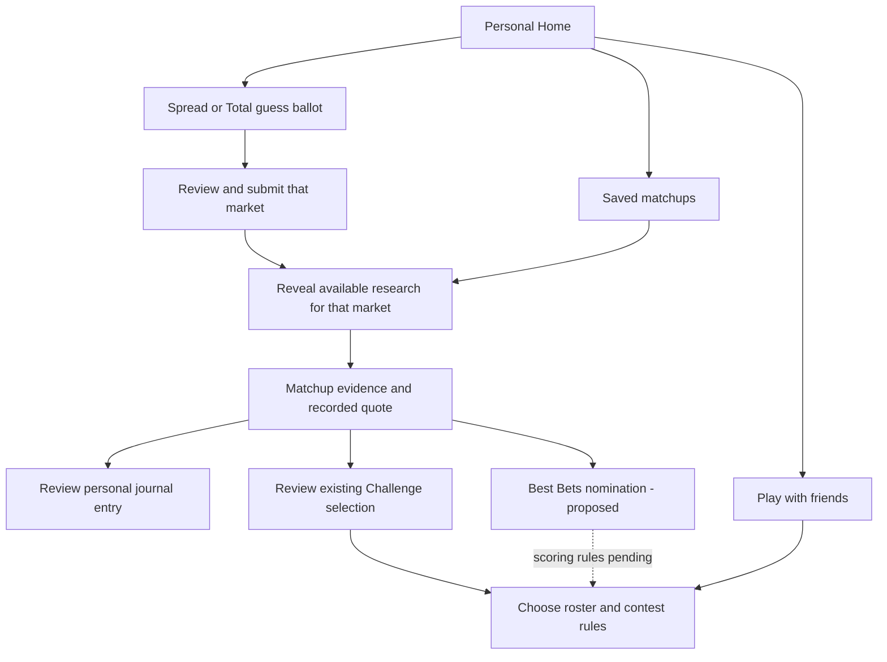

# Guess The Line — personal play and friends workspace

> **Local implementation addendum — October 8, 2026:** The earlier proposal below
> is retained as design history. Solo, Favorites/notes, private forecasts and the
> personal journal now have local SQL/API/UI implementations and tests. The journal
> records optional manually entered stakes, returns and outcomes by currency; it
> does not place bets or transfer money. Hosted delivery remains outstanding.
> [D-16](SUBMISSION_TIME_SCORING.md) supersedes any permanent Spread/Total lock below:
> predeadline edits capture a new reference only for changed guesses. Challenge
> selections remain immutable. Best Bets/friends contest terms remain undecided.
> See the [account worker report](../planning/worker-reports/accounts-and-personal-play.json)
> and [tracker](../planning/project-tracker.json) for current evidence and acceptance.

Owner: Sean Balsiger · UX proposal · October 8, 2026

This proposal responds to the request for Solo tracking, play with friends, head-to-head contests, Favorites and an optional weighted Best Bets subset. It is a product plan, not evidence that these features are deployed. Preserve the icon-only Field monogram from D-14, the accessible site name, and the existing provisional theme tokens. No new brand choice is proposed.

The experience should answer three questions quickly: **What needs my attention? What do these numbers tell me? Where did I record my choice?** Guess accuracy, betting records and competition standings must each retain their own meaning.

## Product boundaries

| Area | User purpose | Primary result | Boundary |
| --- | --- | --- | --- |
| **Guesses** | Predict the hidden sportsbook Spread and Total benchmarks. | Separate accuracy points and closest-pick W–L–T. | One permanently locked submitted ballot per account/week/market, reused across groups. |
| **Research** | Compare a submitted guess with the recorded market and eligible model forecasts. | Point gaps, agreement/disagreement and source evidence. | A benchmark guess is not an outcome forecast. A gap is not a win probability or expected value. |
| **Journal** | Track a personally recorded spread or Over/Under selection and later review its outcome. | Pending selections and W–L–P, with source and recorded price. | A journal entry is not an executed wager or automatically a contest entry. Multiple-entry behavior and any monetary accounting need separate decisions. |
| **Play** | Compare results with friends or enter a contest. | Standings for that roster and the chosen rules. | Existing Challenge remains one immutable spread OR total per NFL matchup, reused across groups. |
| **Favorites** | Keep a private shortlist of matchups worth revisiting. | Saved matchups and optional notes. | Saving is not submitting, recommending, betting or opting into notifications. |
| **Best Bets** | Designate a smaller set of the player's preferred selections for a contest. | A visibly separate subset and, if approved, declared weights. | This name identifies the user's chosen picks, not app-certified profitable bets. Scoring and eligibility are not confirmed. |

**D-15 confirmed:** Best Bets is a separate optional contest. Existing Challenge rules and historical selections remain unchanged. Selection-count limits, allowed weights, ties, locks and settlement still need their own recorded rules; do not invent them or retroactively reweight records.

## Mobile navigation

Use five labeled bottom destinations, with the same order on desktop. Keep the current Field monogram icon alone in the header; place week and account/context controls beside it rather than reintroducing a visible wordmark.

| Destination | Landing content | Secondary views |
| --- | --- | --- |
| **Home** | Personal weekly summary and the next unfinished action. | Spread/Total accuracy, saved shortlist, pending recorded selections and active friends contests. |
| **Guesses** | Spread / Over–Under segmented control; draft or submitted ballot. | Accuracy details, comparison with eligible opponents, source/scoring history. |
| **Research** | Matchups with compact guess / market / model comparison. | All / Saved / Largest gaps / Agreement filters; expanded evidence and recorded line history. |
| **Play** | Active friends contests and a clear Create or join action. | Head-to-head, group standings, existing Challenge and the proposed Best Bets contest. |
| **Journal** | Pending / Settled / All personal records. | Selection detail, result source, corrections and personal performance. |

Account, appearance, notification delivery settings and Design Lab belong behind the account control. History should open within the relevant activity; a separate technical audit remains reachable through each detail view and account exports. Favorites gets an explicit bookmark control and a Saved filter in Research, plus a Home shortcut. It does not need a sixth primary destination.

**Solo is the default personal workspace, not a dummy group.** A person should be able to track their own activity without first creating a Duel or inviting anyone. Selecting a competition changes its roster/comparison context, not the person's weekly guesses or saved personal research. Solo eligibility, identity and private API access still require implementation; changing navigation alone cannot supply them.

## Home card hierarchy

Show a small number of meaningful cards before any expanded tables. Use the selected dashboard layout preference where it helps, but preserve the order of urgent actions and clear labels across every layout.

1. **This week / next action:** one concise status such as incomplete Spread ballot, unfinished Over/Under ballot, or submitted guesses ready to review. Use an actual known deadline; never manufacture a countdown. A missing official freeze is a distinct status from a player's submitted ballot.
2. **Your accuracy:** two equal tiles for Spread and Over/Under, each with points, a small truthful trend when recorded history exists, and Provisional / Frozen / Unavailable text. Tap for per-game errors and closest-pick record. Do not combine the two scores by default.
3. **Research shortlist:** three saved or largest-gap matchups with available evidence. Each card leads with the matchup, two or three comparison numbers, and an explicit source-age label. One primary action opens research; the bookmark remains a separate button.
4. **Your selections:** pending Journal records and any Best Bets nomination, clearly labeled by destination. Do not blend personal records, contest picks and guessed lines into a single unexplained total.
5. **Playing with friends:** compact contest cards with opponent/group name, entry state and the appropriate record. A new player gets a Create or join action; no fictitious opponent or leaderboard is shown.

On a small screen, cards remain one column. Charts are summaries, not decorative filler: missing history becomes a readable value with a timestamp, and a single observation remains a single observation. Information expands inside a card or in a focused detail sheet with a visible Close control, keyboard support and restored focus.

## Matchup detail and decision flow

Use a single reusable detail view from Home, Research, Favorites and contest review. Keep an explicit **Spread / Over–Under** selector. Its first screen should contain:

| Order | Content | Interaction |
| --- | --- | --- |
| 1 | Matchup, home/away labels, verified scheduled kickoff and Saved state. | Bookmark toggles privately without changing a ballot. |
| 2 | Your original guess · current saved market reference · eligible model forecast. | Each number opens its meaning, source, time and status. Missing model means “Model unavailable,” not zero. |
| 3 | Two comparison signals: guess gap and model gap; agreement or disagreement only when both can be calculated. | Tap to inspect signed direction and input dependence. Never average the guess and model into an unsupported forecast. |
| 4 | Recorded movement sparkline with latest value and collection time. | Expand to the full timestamped chart and source table. Future collection is not represented as a live ticking line. |
| 5 | A specific named-book quote if available, with side, line, odds and time. | Review a selection. A derived median cannot be selected as though it were a book's offered price. |
| 6 | Licensed expert context, supporting statistics, notes and sample coverage. | Expand source details; show a link to permitted outside material when display rights are not available. No invented quotes, consensus or expert endorsements. |

Before review, the action must say what it will do: **Record in Journal**, **Review Challenge selection**, or **Nominate for Best Bets**. Do not use one ambiguous “Pick” button for all three. Recording a selection requires an explicit review showing destination, market, side, line, price and source time. A nomination does not submit a wager or change the original guess.

The Saved path in this diagram does not bypass submission. A person who has not submitted that market sees matchup identity, kickoff and private notes, with the research values concealed. Paired team-score forecasts reveal both spread and total and require both submission gates. Notifications, preview cards, exports and deep links must enforce the same rule.

## Core flows

| Flow | Proposed experience | Required protection / exit condition |
| --- | --- | --- |
| First Solo visit | Sign up → personal Home → enter Spread and/or Over/Under guesses → review and submit → available research. | No invitation requirement, no duplicate weekly ballot; persistent account data works across devices. |
| Start head-to-head | Play → create a named contest → select an implemented ruleset → invite → recipient accepts → both see entry status. | Show rules before acceptance; reuse locked weekly picks where applicable. An invitation alone does not enroll or expose the recipient's selections. |
| Save research | Bookmark a matchup → optional personal note → Saved filter → reopen the same market. | Private by default. Saving must not imply agreement, public sharing or notification consent. |
| Record a personal choice | Matchup → named-book quote or explicit manual record → destination review → save → Pending record. | Label user-entered values and later manual outcomes honestly. Do not claim sportsbook confirmation, automatic grading or money transfer. |
| Add Best Bets | Choose from eligible selections → mark a smaller subset → optionally assign allowed weights → review contest card. | D-15 establishes a separate contest. Block scoring/submission until count limits, weights, ties, locks and settlement are resolved. Never reweight an already settled selection retroactively. |
| Revisit after a game | Journal or Play → final result when verified → record and history. | Pending when results are missing. Corrections retain history; provisional guess accuracy does not settle a spread or total selection. |

Journal-based research and any future selection-entry shortcut also need an explicit pre-submission exposure treatment. Do not silently certify blind play after a player has viewed or entered outside market information, and do not relax existing reveal gates merely to make the new navigation work.

## Existing navigation friction

Evidence is the current `web/src/App.jsx`, `web/src/GameHub.jsx`, and `docs/DECISION_WORKSPACE.md`, reviewed October 8. These findings describe current code, not usability testing with real participants.

| Current behavior | Why it becomes confusing | Proposed correction |
| --- | --- | --- |
| My games is the entry point and creation offers Duel/Group. | Solo users face a social setup task before their personal work. | Personal Home first; friends contests live under Play. |
| My picks changes meaning with Spread, Total or Challenge mode. | A hidden-line guess and a recorded side/price both look like a “pick.” | Guesses and Journal have explicit names; Challenge remains a contest destination. |
| Compare picks and Leaderboard are separate top-level entries. | Navigation is organized around screens rather than the activity the person is doing. | Comparison and standings are contextual views inside Guesses or Play. |
| Edge board implies actionable advantage while the model is unavailable. | A guess-to-market discrepancy can be mistaken for betting advice. | Research / Largest gaps, with the two inputs and evidence visible. Use “edge” only with its precise, supported definition. |
| History & audit combines movement, score history and technical revisions. | It mixes research history, performance and account provenance. | Movement within Research; performance within Guesses/Journal; audit on detail/export paths. |
| Dashboard action tiles go to a ballot/card; its separate market tabs select dashboard data. | Several similar controls change different things. | Keep market selectors local to the current activity, and use explicit “Open ballot” or “Open record” actions. |
| Group switching surrounds globally reused weekly picks. | A user may expect a new ballot or a different set of selections in each group. | Keep a visible account/week ownership label; change roster and standings context only. |

## Reusable components and honest states

Reuse the existing Field monogram, TeamMatchup, source-age labels, disclosure behavior, chart interaction, tokens and reduced-motion preferences. New components should have one job:

| Component | Needed states |
| --- | --- |
| **Activity summary** | Draft, submitted, provisional, frozen, no reference; correct scoring unit and destination. |
| **Research strip** | Submitted-market permission, own guess, dated market, eligible model, unavailable/stale source, signed comparison. |
| **Save button** | Saved/unsaved, in-progress write, failed write with retry; accessible name identifies the matchup. |
| **Selection review** | Journal / Challenge / Best Bets destination; actual or user-entered quote; conflicts and permanent locks visible before confirmation. |
| **Contest card** | Invited, accepted, entry incomplete, active, provisional, settled; no implied stake or transfer. |
| **Result row** | Pending, verified W/L/P, corrected with audit; no fabricated settlement. |
| **Evidence drawer** | Source, observation time, collection time, model version/validation, coverage and permission-compatible expert attribution. |

Current data limitations carry through every surface: the historical GTL prototype is not approved for weekly suggestions; no current model forecast, licensed outside forecast feed, public betting split/count feed or verified sharp-action feed is established. Twelve-hour saved odds are research references, not continuously current offers. Official Total scoring and actual kickoff freeze remain separate work. Push/email/SMS are not activated by a Saved toggle or an in-page notice setting. Team-logo activation remains subject to the source record in `VISUAL_POLISH.md`.

## Running list for the main tracker

These are proposal entries owned by the primary workflow until assigned. They are not marked implemented or accepted. Add them to the existing tracker rather than creating a second competing source of status.

| ID | Priority | Item / current state | Dependency | Exit condition |
| --- | --- | --- | --- | --- |
| PLAY-UX-01 | P0 | Solo personal Home — requested, not implemented | Account-scoped private views and history | A person can use the core personal flow with no group membership; existing shared weekly entries are reused. |
| PLAY-UX-02 | P0 | Best Bets scope — confirmed separate contest under D-15 | Rules design and implementation | Preserve past picks and existing Challenge scoring when adding the separate contest. |
| PLAY-UX-03 | P0 | Clear Guesses / Research / Journal / Play separation — proposed | Naming review and route migration | Users can identify what each action records before confirmation; old links preserve destination and market. |
| PLAY-UX-04 | P1 | Favorites and private research notes — requested | Private persistence, reveal-safe previews | Save/open/remove works across devices; saved data never enters a contest automatically. |
| PLAY-UX-05 | P1 | Personal journal — requested | Entry, outcome and correction schema; exposure treatment | Pending and settled records persist with provenance, without implying real wager execution. |
| PLAY-UX-06 | P1 | Friends/head-to-head contest entry — requested | Implemented ruleset, invitation acceptance and privacy | Both participants see the same accepted rules and appropriate selections/standings. |
| PLAY-UX-07 | P1 | Best Bets subset and optional weights — unconfirmed rules | PLAY-UX-02; limits, lock, ties and settlement decisions | Explainable scoring preview matches eventual results and retains immutable nomination history. |
| PLAY-UX-08 | P1 | Matchup research strip and evidence drawer — proposed | Eligible data, existing independent reveal gates | The two comparison signals can be inspected without mistaking a guess gap for a calibrated advantage. |
| PLAY-UX-09 | P2 | Personal performance filters — proposed | Sufficient verified results | Spread / Total, week and source views include sample counts; no misleading small-sample ranking. |
| PLAY-UX-10 | P2 | Follow-up reminders for saved/unfinished activity — proposed | Delivery integration, opt-in, quiet hours and privacy | User chooses channel and event; delivery is verified, deduplicated and easy to disable. |
| PLAY-UX-11 | P2 | Reasons and postgame review — proposed | Private notes and verified results | A person can revisit their original rationale alongside the actual outcome without editing history. |
| PLAY-UX-12 | P2 | Later research categories — proposed | Licensed inputs and sufficient value | Add one at a time: injuries/availability, matchup stats, weather or permitted expert context; all show source and time. |

Prioritize Solo access and clear ownership first, then Favorites and explicit selection destinations. D-15 fixes Best Bets as separate; its detailed scoring still needs definition. Richer stats and expert callouts should follow the data-quality work, not become empty navigation categories or invented dashboard content.
