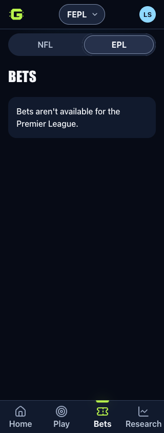
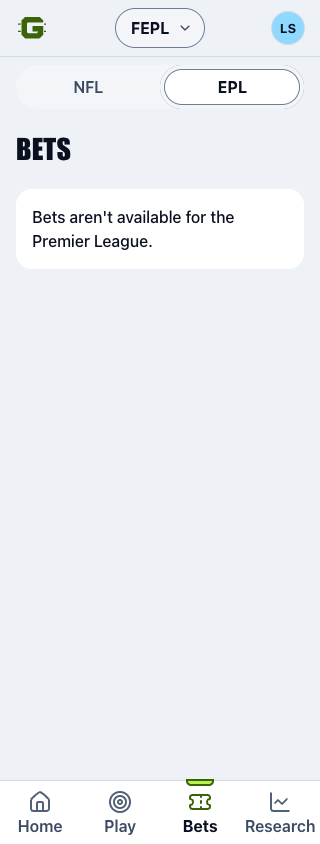

# Shared NFL and EPL interface

Owner: Sean Balsiger · Confirmed October 29, 2026

Sean confirmed one shared interface with sport-specific game modes. Switching
NFL/EPL keeps the current primary section: Home, Play, Bets or Research.
Research → Fantasy maps to Fantasy in the other sport. Other sport-specific
subsections open the same primary section's default mode; NFL week, matchup,
player and league filters never become EPL parameters.

The account provider remains mounted across sport changes. Both sports use the
same frame, avatar/profile menu, appearance/settings controls, offline banner,
keyboard skip link, fixed navigation and Back/Forward behavior. The league pill
shows the selected NFL league or FEPL. EPL keeps its own Pick a Team and Fantasy
content; this work does not create EPL copies of NFL games.

Cold EPL entry reads the account lobby and EPL content. It does not load NFL
picks or Community gameplay. The account menu requests the existing authenticated
Community read on demand to determine commissioner access. Only the server's
existing admin flag enables the existing commissioner tools; each tool retains
its server authorization. EPL tabs never display NFL due-pick counters. Automatic
refresh in EPL updates account data without polling previously visited NFL reads.

Profile edits use the same account-scoped draft and explicit-save flow in both
sports. Account changes still discard the previous account's mounted state.
Neither switching sports nor opening Profile writes a pick or a profile.

## Sport-specific availability

At this source revision, EPL Bets keeps its existing unavailable state. EPL
History remains accessible in the same menu and explains that its view is not
available yet, with an explicit path to retained NFL history. Existing
`play/guess` and `play/leaderboard` routes remain reserved for the separate EPL
moneyline implementation. That work is coordinated with the **Review Guess the
Line progress** chat and is not claimed complete by this interface change.

The child contract reserved for that follow-on is `guess/EplGuess.jsx` with
`{ api, accountId, onNavigate }` and `guess/EplGuessLeaderboard.jsx` with
`{ api, accountId, season? }`. EPL matchweek comes from EPL server data. Shell
integration must not substitute the currently selected NFL week.

## Verification and release boundary

Local verification on October 29:

- 71 routing, navigation-state, data-store, sport-boundary and token tests passed.
- All 572 component/scoring tests passed, including 50 EPL component tests.
- Four existing EPL browser acceptance tests passed with disposable SQL.
- 27 browser tests passed across the shared frame, profile and new sport-switch
  checks. They cover all four tabs, Back/Forward, one retained account read,
  cross-sport profile save/readback, draft protection and commissioner access.
- Light and Dark checks at 320px and 390px passed automated accessibility and
  overflow checks. The 320px screenshots below were visually reviewed.
- Typecheck, Brand QA and a cloud build with fixture configuration passed; the
  public bundle scan found no private state, contacts, source files or credentials.
- Three final browser checks passed after the shared skip-link change, including
  retained NBA entry/return and draft guards. There are 32 unique browser checks
  across these runs.

These are local tests using synthetic accounts and disposable data. They do not
establish hosted deployment, physical-iPhone acceptance or completion of other
EPL features. No migration, production data write or deployment is part of this
change. Release remains coordinated with **Hide NBA and deploy EPL items**.

| Dark, 320px | Light, 320px |
| --- | --- |
|  |  |
